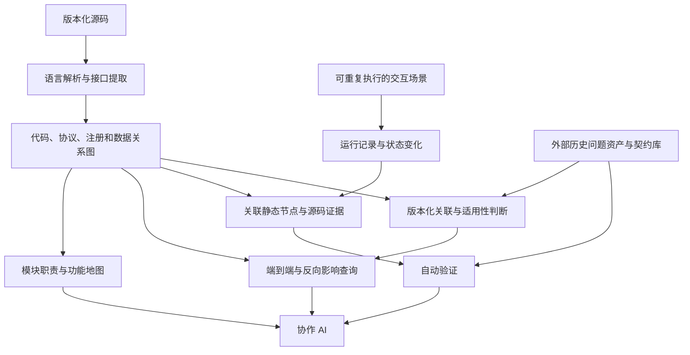

# Project Map Research

研究如何为 AI 协作开发自动维护一份可查询、可追溯、与代码版本对应的项目模型。

目标：让 AI 能从业务入口查到跨模块、跨语言、直到数据库及返回消费者的关系，并结合运行证据判断修改影响。首个研究对象是 [MindStudio Insight](https://gitcode.com/Ascend/msinsight)。

**设计范围 v0.1**：项目地图、代码/接口/数据关系图、运行行为与证据，并关联团队维护的历史问题资产与契约库。三个视图共用版本、来源和覆盖缺口，详见 [设计基线](docs/05-design-baseline.md)。

**P1、P2 已完成，F01–F05、L01–L06 通过。** 主底座 CGC/Kuzu，复用 TypeScript 编译器与 C++ 语法/类型候选。P2 从源码提取字段转换、协议身份和注册，三条前端请求可正反向查到各自后端处理函数，改名与隔离负例通过。见 [P2 报告与复现](experiments/2026-10-23-p2/README.md)、[P1 底座决策](experiments/2026-10-23-p1-completion/README.md)。P3 的数据库候选与共享实例检查 D01、D04 已在所选源码范围通过，响应数据流继续实施，见 [数据库选择与实例报告](experiments/2026-10-23-p3/selection.md)；实施安排见 [研究计划](plans/README.md)、[详细计划书](plans/implementation-plan.md)和 [验收矩阵](plans/acceptance-matrix.md)。

## 我们要解决的问题

研究重点是恢复协议、路由注册、虚函数实现、共享数据和异步状态之间的连接，并用源码依据和场景断言检验这些关系。

希望 AI 可以查询：

- `getUnitFlows` 发出的请求由哪个后端处理器接收？依据是什么？
- `QueryUnitFlows` 有哪些候选实现，什么条件下选择它们？
- 修改返回字段、数据库查询或公共通信层，会涉及哪些消费者？
- 查询期间切换项目，旧响应是否被丢弃？哪个场景验证过？
- 当前地图对应哪个提交？哪些关系尚未解析、哪些路径尚未运行验证？
- 本次修改涉及哪些历史问题和契约？适用什么条件，哪些回归已在当前版本验证？

## 研究对象



事实提取、关联、更新和检查尽量由可重复的程序完成。AI 用于辅助研究、总结和提出候选关系；未经验证的推断必须单独标注。

## 从这里开始

| 文档 | 内容 |
|---|---|
| [研究目标与范围](docs/01-problem-and-scope.md) | 什么算成功，哪些内容由其他团队维护 |
| [设计基线 v0.1](docs/05-design-baseline.md) | 三个视图、历史问题契约库协作、范围与成功条件 |
| [研究计划](plans/README.md) | 阶段、里程碑、依赖、工作量假设和当前状态 |
| [详细计划书](plans/implementation-plan.md) | 适配与选型、数据约定、更新、运行和历史资产接入 |
| [验收矩阵](plans/acceptance-matrix.md) | 正反例、证据要求、必需与扩展范围 |
| [统一关系与接口模型](docs/02-project-model.md) | 如何连接跨语言接口，如何保留条件和证据 |
| [unit/flows 案例](cases/unit-flows/README.md) | 已核实源码、断点、待提取关系与静态验收题 |
| [动态行为与审查](docs/03-runtime-and-review.md) | 状态、时序、追踪、场景和回归验证 |
| [工具调查](research/tools.md) | 已实测工具、源码核对候选、许可证与限制 |
| [已有实测记录](research/experiments/2026-10-23.md) | Windows 试验的版本、结果和证据边界 |
| [CodeGraph / code-map 新实测](experiments/2026-10-23-unit-flows/README.md) | 原版能连接到哪里、HTTP 对照、更新差异、证据与复现脚本 |
| [P1 统一对照与事实补充](experiments/2026-10-23-p1/README.md) | CBM/CGC/CodeGraph 相同输入、独立语法补充、存储维护及剩余门槛 |
| [P1 完成报告](experiments/2026-10-23-p1-completion/README.md) | F01–F05、最终选型、类型/绑定/回调、两种数据库维护和复现 |
| [P2 完成报告](experiments/2026-10-23-p2/README.md) | L01–L06、名称与字段传播、作用域、三条双向路径与反例 |
| [P3 实施记录](experiments/2026-10-23-p3/README.md) | 数据库候选路径、工厂与状态来源、间接影响和剩余门槛 |
| [P3 响应字段生产](experiments/2026-10-23-p3/output-fields.md) | 按调用位置展开引用参数，自动找到响应字段的七处写入 |
| [P3 响应序列化](experiments/2026-10-23-p3/serialization.md) | 从源码恢复注册回调及 34 个 JSON 字段/集合路径，保留条件和缺口 |
| [P3 响应对象与路由](experiments/2026-10-23-p3/response-routing.md) | 按对象、模块与命令连接四个发送位置到序列化回调，区分发送前后的写入 |
| [P3 前端消费与状态](experiments/2026-10-23-p3/frontend-consumers.md) | 区分返回字段依赖和请求完成后更新，查询两个入口的状态赋值 |
| [P3 响应回调与 Promise](experiments/2026-10-23-p3/response-callbacks.md) | 回调表、查找键、闭包与成功/失败交付，保留项目切换条件 |
| [P3 请求编号关联](experiments/2026-10-23-p3/request-correlation.md) | 发送字段、C++ 解码/复制/序列化和响应查找键的来源关系 |
| [P3 C++ 响应发送](experiments/2026-10-23-p3/transmission.md) | JSON 字符串、按值捕获、延迟回调和 socket 发送参数，保留编码分支缺口 |
| [P3 socket 接收绑定](experiments/2026-10-23-p3/socket-receivers.md) | 原生创建、发送字段、接收函数及事件参数到回调表的来源关系 |
| [P3 服务端通道来源](experiments/2026-10-23-p3/server-channels.md) | 接受连接、会话 channel 初始化、管理器保存/读取和响应发送的来源关系 |
| [P3 iframe 返回与 API 解包](experiments/2026-10-23-p3/return-bridge.md) | 返回包装、消息编号与目标窗口、API 字段投影、状态赋值和反查 |
| [下一轮实验](experiments/README.md) | 如何公平比较，优先验证哪些问题 |
| [讨论清单](docs/04-research-agenda.md) | 今天要逐项回答的问题与决策门槛 |
| [资料来源](research/sources.md) | 论文、仓库、官方文档及固定版本 |

案例的机器可读研究基准在 [reference.json](cases/unit-flows/reference.json)，由人工对照源码形成，保存参考事实与待验证项，用于评价自动提取结果。

## 本地检查

只需要 Python 3.11 或更新版本，不安装第三方依赖：

```sh
python scripts/check_research.py
python scripts/check_trial_evidence.py
python scripts/check_p1_evidence.py
python scripts/check_p1_completion.py
python scripts/check_p2_completion.py
python scripts/check_p3_increment.py
python scripts/check_p3_selection.py
python scripts/check_p3_output_fields.py
python scripts/check_p3_serialization.py
python scripts/check_p3_response_routing.py
python scripts/check_p3_frontend_consumers.py
python scripts/check_p3_response_callbacks.py
python scripts/check_p3_request_correlation.py
python scripts/check_p3_transmission.py
python scripts/check_p3_socket_receivers.py
python scripts/check_p3_server_channels.py
python scripts/check_p3_return_bridge.py
python scripts/verify_case_sources.py --repo /path/to/msinsight
```

前十五条检查文档、案例和实测证据的一致性，不重新核验文件哈希。最后一条在固定提交的本地 Insight checkout 中核实案例锚点；均不执行 Insight，不联网。适配器测试需 `python -m pip install -r requirements-store.txt`，随后执行 `python -m unittest discover -s tests -v`；TS 测试执行 `npm ci --ignore-scripts --no-audit --no-fund` 和 `npm test`。源码构图和查询见 [P1 复现步骤](experiments/2026-10-23-p1-completion/reproduce.md)。

## 协作原则

- 优先复用已有实现，先验证接口连接能力，再决定适配范围。
- 分清已实测、源码核对、官方文档声明、研究方案和未知项。
- 每条关键关系带来源、位置、版本和解析依据；缺边不代表没有依赖。
- 完整性分为代码覆盖、接口匹配覆盖、场景覆盖和行为断言覆盖，分别报告。
- 不把第三方源码、模型、虚拟环境、数据库、敏感数据和大型 trace 加入仓库。

本仓库自有内容采用 [MIT](LICENSE)。第三方项目保留各自许可证，链接不构成代码再授权。使用 GitHub 连接器完成了部分源码调查；研究记录中的对应仓库和源码链接可直接查阅。
