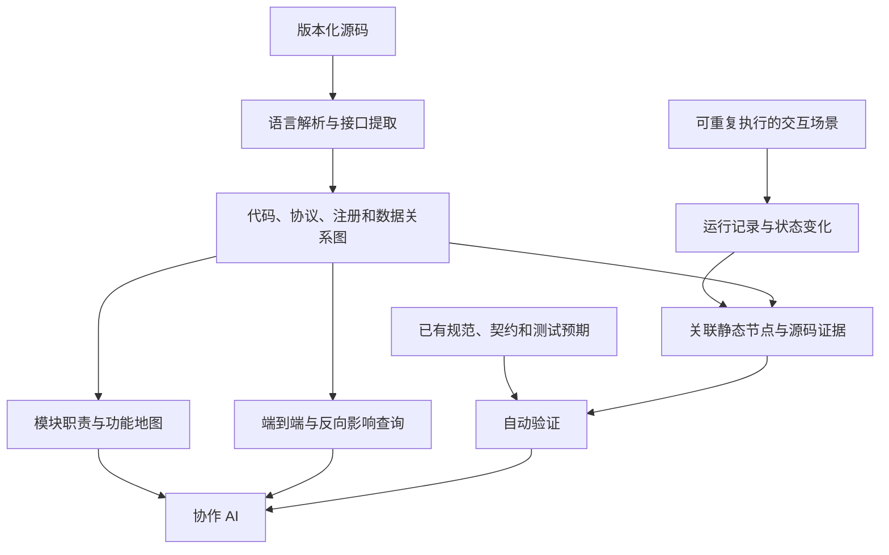

# Project Map Research

研究如何为 AI 协作开发自动维护一份可查询、可追溯、与代码版本对应的项目模型。

目标：让 AI 能从业务入口查到跨模块、跨语言、直到数据库及返回消费者的关系，并结合运行证据判断修改影响。首个研究对象是 [MindStudio Insight](https://gitcode.com/Ascend/msinsight)。

**当前阶段：研究与选型。尚未实现自动贯通 Insight 的产品，没有完成动态追踪接入，也没有确定最终底座。**

## 我们要解决的问题

通用符号索引能找到函数，却可能遗漏协议、路由注册、虚函数实现、共享数据和异步状态之间的连接。漂亮的图、较多的节点、一次成功执行，都不能证明关系完整或行为正确。

希望 AI 可以查询：

- `getUnitFlows` 发出的请求由哪个后端处理器接收？依据是什么？
- `QueryUnitFlows` 有哪些候选实现，什么条件下选择它们？
- 修改返回字段、数据库查询或公共通信层，会涉及哪些消费者？
- 查询期间切换项目，旧响应是否被丢弃？哪个场景验证过？
- 当前地图对应哪个提交？哪些关系尚未解析、哪些路径尚未运行验证？

## 研究对象



事实提取、关联、更新和检查尽量由可重复的程序完成。AI 用于辅助研究、总结和提出候选关系；未经验证的推断必须单独标注。

## 从这里开始

| 文档 | 内容 |
|---|---|
| [研究目标与范围](docs/01-problem-and-scope.md) | 什么算成功，哪些内容由其他团队维护 |
| [统一关系与接口模型](docs/02-project-model.md) | 如何连接跨语言接口，如何保留条件和证据 |
| [unit/flows 案例](cases/unit-flows/README.md) | 已核实源码、断点、待提取关系与静态验收题 |
| [动态行为与审查](docs/03-runtime-and-review.md) | 状态、时序、追踪、场景和回归验证 |
| [工具调查](research/tools.md) | 已实测工具、源码核对候选、许可证与限制 |
| [已有实测记录](research/experiments/2026-10-23.md) | Windows 试验的版本、结果和证据边界 |
| [下一轮实验](experiments/README.md) | 如何公平比较，优先验证哪些问题 |
| [讨论清单](docs/04-research-agenda.md) | 今天要逐项回答的问题与决策门槛 |
| [资料来源](research/sources.md) | 论文、仓库、官方文档及固定版本 |

案例的机器可读研究基准在 [reference.json](cases/unit-flows/reference.json)。它是人工对照源码形成的参考事实与待验证项，**不是自动工具生成的完整图**。

## 本地检查

只需要 Python 3.11 或更新版本，不安装第三方依赖：

```sh
python scripts/check_research.py
python scripts/verify_case_sources.py --repo /path/to/msinsight
```

第一条检查文档内部链接和案例记录。第二条在固定提交的本地 Insight checkout 中核实案例锚点；不执行 Insight，不联网，也不构建完整调用图。

## 协作原则

- 优先复用已有实现，先验证接口连接能力，再决定适配范围。
- 分清已实测、源码核对、官方文档声明、研究方案和未知项。
- 每条关键关系带来源、位置、版本和解析依据；缺边不代表没有依赖。
- 完整性分为代码覆盖、接口匹配覆盖、场景覆盖和行为断言覆盖，分别报告。
- 不把第三方源码、模型、虚拟环境、数据库、敏感数据和大型 trace 加入仓库。

本仓库自有内容采用 [MIT](LICENSE)。第三方项目保留各自许可证，链接不构成代码再授权。使用 GitHub 连接器完成了部分源码调查；研究记录中的对应仓库和源码链接可直接查阅。
