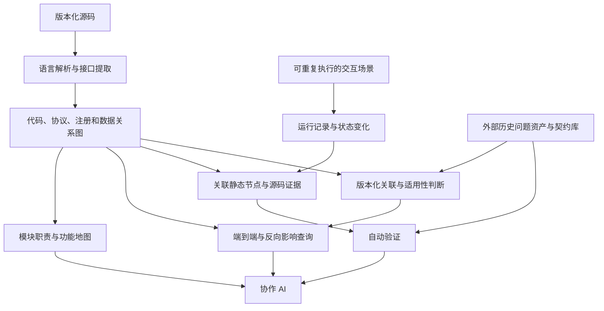

# Project Map Research

研究如何为 AI 协作开发自动维护一份可查询、可追溯、与代码版本对应的项目模型。

目标应用是多语言、跨进程、强交互、数据密集型的桌面/Web 分析软件，首个验收对象为 MindStudio Insight。当前[执行计划 R0–R5](plans/reuse-first-execution-plan.md)已与最新组件实测对齐：优先集成现成实现，逐阶段交付并按全仓范围验收。

**2026-10-26：R0/R1 已启动实施。** [实施记录](experiments/2026-10-26-r0-r1/README.md)已交付 CBM 隔离启动、原生 C++ 语义、TypeScript 声明/依赖及正式提供方接入结果。正在按[复用优先计划](plans/reuse-first-execution-plan.md)构建同版本全仓快照并核查 129 个组件。历史资产关闭，原始 Insight checkout 保持只读，新增工具与数据均放 D 盘。

前期[源码接口与复用决定](research/reuse-source-contracts-2026-10-26.md)和[原生组件审计](experiments/2026-10-26-reuse-audit/README.md)记录首次结果；CBM 启动问题已在本轮恢复。SCIP 投影误差、Joern 别名/Rust 及编译诊断仍按实际范围保留，不据此宣称全项目技术验收通过。

**整体状态：Insight 全项目关系覆盖尚未通过验收。** 当前按[全项目实施计划](plans/project-wide-completion-plan.md)补齐全部自有运行模块、Python/JavaScript/Rust、跨模块边界、数据/状态与运行证据；完成条件见[整体验收矩阵](plans/project-wide-acceptance.md)。[W0 完成，G01 通过](experiments/2026-10-25-w0/completion.md)：已冻结 129 个必需组件、19 项独立边界/接口参考和 85 项运行模式义务。[W1 执行中](experiments/2026-10-25-w1/README.md)，已保存 185 个 JS/Python/Rust 文件的上游原生输出，[JS 混合模块](experiments/2026-10-25-w1/javascript.md)和 [Python 基础事实、代理接口](experiments/2026-10-25-w1/python.md)已接入全仓图并验证自动更新；[Rust 已接入生产图并通过启动/加载查询与独立安装验证](experiments/2026-10-25-w1/rust.md)，[同一默认全仓快照复验已通过](experiments/2026-10-25-w1/repository-recheck.md)，G02 尚未通过，W2–W7 继续按计划展开。

工具按语言和技术机制工作；新增业务模块应自动发现、连接和更新。模块/接口名称由源码提取，Insight 是当前验收对象。见[项目扩展与自动发现](docs/08-project-independent-discovery.md)。

[CMake 构建产物已接入统一查询](experiments/2026-10-25-w1/cmake-native.md)：真实 C++/CMake 控制快照 32 项检查通过，可查构建目标、完整产物路径、编译输入、依赖和 C++ 入口。Python 打包连接见下项，Rust 启动路径继续展开；多语言全仓、逐模块机制和运行门槛分别验收。

[Python 打包已连接原生构建产物](experiments/2026-10-25-w1/python-packaging.md#insight-原生产物到发行目录控制)：同版本控制的 29 项检查通过，后端可执行文件自动连到归一化、桌面和 JupyterLab 发行目录，六项正反向查询通过。12 个原生预期文件派生 24 个带条件的复制产物；Rust 启动配对、剩余路径/移动效果及实际运行继续验收。

**已有底座：[project-map-assistant skill](skills/project-map-assistant/SKILL.md) 与可独立安装的工具。** 已验证 TS/C++ 的部分关系、自动更新、查询和限定运行场景；见 [使用说明](docs/07-tool-quickstart.md)。先完成全项目技术验收，再比较源码组与源码＋工具组；历史资产第三组独立安排，当前不接入。

[skill 分发及限定范围验收](experiments/2026-10-25-tool-skill/completion.md)：17 项独立仓库、20 项 Insight 安装后查询、359 项 Python 和 110 项 TypeScript 检查通过。这些是已有实现及分发的检查，不是全项目关系覆盖通过；“Python 测试”也不表示已支持 Python 源码分析。完整分发包可由 GitHub Actions 构建并下载。

目标：让 AI 能从业务入口查到跨模块、跨语言、直到数据库及返回消费者的关系，并结合运行证据判断修改影响。首个研究对象是 [MindStudio Insight](https://gitcode.com/Ascend/msinsight)。

以下 P/A 阶段按当时限定输入和场景保留原验收结论；全项目完成由 G01–G08 单独判定。

**设计范围 v0.1**：项目地图、代码/接口/数据关系图、运行行为与证据，并关联团队维护的历史问题资产与契约库。三个视图共用版本、来源和覆盖缺口，详见 [设计基线](docs/05-design-baseline.md)。

**P1–P5 已完成；P7 独立交付范围已完成；P6 历史资产接入待办。** 主底座为 CGC/Kuzu，复用 TypeScript 编译器及 C++ 语法/类型候选。P7 枚举全仓 4,855 个文件，其 191 输入历史基准恢复三条协议链，其中 unit/flows 与 memoryUsage 的返回字段连接到前端状态。见 [P7 验收报告](experiments/2026-10-24-p7/completion.md)和[能力覆盖矩阵](docs/06-capability-coverage.md)。最新全仓地图见 [A3 自动概览](experiments/2026-10-24-a3/evidence/project-map.md)；P6 完成后再进行 M3 联合验收。

P4 的自动刷新、失败恢复及历史记录版本关联已通过，[P5](experiments/2026-10-24-p5/completion.md)已验证 unit/flows 的正常、迟到、并发关联和故障断言。旧运行保留原版本；memoryUsage 的真实运行与资源占用尚未验证。计划和阶段边界见 [研究计划](plans/README.md)、[详细计划书](plans/implementation-plan.md)及[验收矩阵](plans/acceptance-matrix.md)。

**A1 全仓自动发现已完成**：[完成报告](experiments/2026-10-24-a1/completion.md)。全仓 4,855 个路径保留处理状态，自动纳入 2,256 个 TS/TSX、C++/头文件及 54 个构建清单，输出基础事实和候选。自动策略已接入刷新器。

**A2 全仓静态连接已完成**：[完成报告](experiments/2026-10-24-a2/completion.md)。2,310 个自动输入生成 271,737 个节点、386,100 条关系；109 个协议提供方候选、96 条唯一有条件匹配记录。三条已知链在同一全仓图上回归，独立重建内容一致；当批 314 项 Python、88 项 TypeScript 和 14 项源码变更检查通过。静态候选、未知项与运行证据分别保留，完整提取产物使用 JSON。

**A3 可展开地图已完成**：[完成报告](experiments/2026-10-24-a3/completion.md)和 [AI 查询示例](experiments/2026-10-24-a3/walkthrough.md)。同一事实集生成 SQLite 导航索引，支持自动模块图、接口/资源正反查、证据分页、预算和固定版本源码导航。27 项全仓检查、当批 329 项 Python、88 项 TypeScript 测试通过；七类新进程查询实测约 0.09–0.25 秒。

**A4 修复复验通过**：[完成报告](experiments/2026-10-24-a4-repair/completion.md)。六条请求到数据生产函数的正反向路径、六个响应字段和两个指定前端状态通过；新增直接入口、13 项刷新、26 项导航、19 项既有链回归及两次完整重建一致性通过。340 项 Python、97 项 TypeScript 测试通过。[首轮未通过结果](experiments/2026-10-24-a4/report.md)与修复中的失败保留。

**2026-10-25 静态连接扩展与 A5 规定场景验收完成。** [静态扩展](experiments/2026-10-25-static-async/completion.md)贯通五项指定连接；[A5 报告](experiments/2026-10-25-a5/completion.md)验证八个真实场景、45 个指定请求、24 个采集负例、缓存生命周期、设备切换和同版本映射。snapshot 的 3,219 条生命周期与 MemScope 的 3,267 条记录通过独立输入核验；受控缺块故障触发断言失败，恢复后通过。资源计量与未映射阶段分别保留，P6 外部历史资产接入继续独立推进。

历史问题样本按[开发与验证划分](datasets/msinsight-regressions/split.md)执行：8 条开发、4 条关联回归、12 条验证候选。本轮用户启动 A4 后，12 条已完成版本与当前静态覆盖登记；未逐条运行复现，也未用于调整提取规则。

## 我们要解决的问题

研究重点是恢复协议、路由注册、虚函数实现、共享数据和异步状态之间的连接，并用源码依据和场景断言检验这些关系。

希望 AI 可以查询：

- `getUnitFlows` 发出的请求由哪个后端处理器接收？依据是什么？
- `QueryUnitFlows` 有哪些候选实现，什么条件下选择它们？
- 修改返回字段、数据库查询或公共通信层，会涉及哪些消费者？
- 查询期间切换项目，旧响应是否被丢弃？哪个场景验证过？
- 当前地图对应哪个提交？哪些关系尚未解析、哪些路径尚未运行验证？
- 本次修改涉及哪些历史问题和契约？适用什么条件，哪些回归已在当前版本验证？

## 研究对象



事实提取、关联、更新和检查尽量由可重复的程序完成。AI 用于辅助研究、总结和提出候选关系；未经验证的推断必须单独标注。

## 从这里开始

| 文档 | 内容 |
|---|---|
| [研究目标与范围](docs/01-problem-and-scope.md) | 什么算成功，哪些内容由其他团队维护 |
| [设计基线 v0.1](docs/05-design-baseline.md) | 三个视图、历史问题契约库协作、范围与成功条件 |
| [能力架构与覆盖矩阵](docs/06-capability-coverage.md) | 系统组成、18 类机制、工具复用与全仓未展开部分 |
| [P7 地图与查询](experiments/2026-10-24-p7/README.md) | 生成地图、CLI、覆盖预检、复现和隔离 AI 任务 |
| [研究计划](plans/README.md) | 阶段、里程碑、依赖、工作量假设和当前状态 |
| [详细计划书](plans/implementation-plan.md) | 适配与选型、数据约定、更新、运行和历史资产接入 |
| [验收矩阵](plans/acceptance-matrix.md) | 正反例、证据要求、必需与扩展范围 |
| [统一关系与接口模型](docs/02-project-model.md) | 如何连接跨语言接口，如何保留条件和证据 |
| [unit/flows 案例](cases/unit-flows/README.md) | 已核实源码、断点、待提取关系与静态验收题 |
| [动态行为与审查](docs/03-runtime-and-review.md) | 状态、时序、追踪、场景和回归验证 |
| [工具调查](research/tools.md) | 已实测工具、源码核对候选、许可证与限制 |
| [已有实测记录](research/experiments/2026-10-23.md) | Windows 试验的版本、结果和证据边界 |
| [CodeGraph / code-map 新实测](experiments/2026-10-23-unit-flows/README.md) | 原版能连接到哪里、HTTP 对照、更新差异、证据与复现脚本 |
| [P1 统一对照与事实补充](experiments/2026-10-23-p1/README.md) | CBM/CGC/CodeGraph 相同输入、独立语法补充、存储维护及剩余门槛 |
| [P1 完成报告](experiments/2026-10-23-p1-completion/README.md) | F01–F05、最终选型、类型/绑定/回调、两种数据库维护和复现 |
| [P2 完成报告](experiments/2026-10-23-p2/README.md) | L01–L06、名称与字段传播、作用域、三条双向路径与反例 |
| [P3 历史实施记录](experiments/2026-10-23-p3/README.md) | 数据库候选路径、工厂与状态来源、间接影响和剩余门槛 |
| [P3 完成报告](experiments/2026-10-23-p3/completion.md) | D01–D05 合并验收、统一整链查询、编码/队列处置及剩余运行条件 |
| [第三条真实链登记](cases/memory-usage/README.md) | Memory/view/memoryUsage 跨模块参考与 P7 冻结规则验收约定 |
| [P3 响应字段生产](experiments/2026-10-23-p3/output-fields.md) | 按调用位置展开引用参数，自动找到响应字段的七处写入 |
| [P3 响应序列化](experiments/2026-10-23-p3/serialization.md) | 从源码恢复注册回调及 34 个 JSON 字段/集合路径，保留条件和缺口 |
| [P3 响应对象与路由](experiments/2026-10-23-p3/response-routing.md) | 按对象、模块与命令连接四个发送位置到序列化回调，区分发送前后的写入 |
| [P3 前端消费与状态](experiments/2026-10-23-p3/frontend-consumers.md) | 区分返回字段依赖和请求完成后更新，查询两个入口的状态赋值 |
| [P3 响应回调与 Promise](experiments/2026-10-23-p3/response-callbacks.md) | 回调表、查找键、闭包与成功/失败交付，保留项目切换条件 |
| [P3 请求编号关联](experiments/2026-10-23-p3/request-correlation.md) | 发送字段、C++ 解码/复制/序列化和响应查找键的来源关系 |
| [P3 C++ 响应发送](experiments/2026-10-23-p3/transmission.md) | JSON 字符串、按值捕获、延迟回调和 socket 发送参数，保留编码分支缺口 |
| [P3 socket 接收绑定](experiments/2026-10-23-p3/socket-receivers.md) | 原生创建、发送字段、接收函数及事件参数到回调表的来源关系 |
| [P3 服务端通道来源](experiments/2026-10-23-p3/server-channels.md) | 接受连接、会话 channel 初始化、管理器保存/读取和响应发送的来源关系 |
| [P3 iframe 返回与 API 解包](experiments/2026-10-23-p3/return-bridge.md) | 返回包装、消息编号与目标窗口、API 字段投影、状态赋值和反查 |
| [下一轮实验](experiments/README.md) | 如何公平比较，优先验证哪些问题 |
| [讨论清单](docs/04-research-agenda.md) | 今天要逐项回答的问题与决策门槛 |
| [资料来源](research/sources.md) | 论文、仓库、官方文档及固定版本 |

案例的机器可读研究基准在 [reference.json](cases/unit-flows/reference.json)，由人工对照源码形成，保存参考事实与待验证项，用于评价自动提取结果。

## 本地检查

只需要 Python 3.11 或更新版本，不安装第三方依赖：

```sh
python scripts/check_research.py
python scripts/check_trial_evidence.py
python scripts/check_p1_evidence.py
python scripts/check_p1_completion.py
python scripts/check_p2_completion.py
python scripts/check_p3_increment.py
python scripts/check_p3_selection.py
python scripts/check_p3_output_fields.py
python scripts/check_p3_serialization.py
python scripts/check_p3_response_routing.py
python scripts/check_p3_frontend_consumers.py
python scripts/check_p3_response_callbacks.py
python scripts/check_p3_request_correlation.py
python scripts/check_p3_transmission.py
python scripts/check_p3_socket_receivers.py
python scripts/check_p3_server_channels.py
python scripts/check_p3_return_bridge.py
python scripts/check_p3_completion.py
python experiments/2026-10-24-p5/check_completion.py
python experiments/2026-10-24-p7/check_completion.py
python scripts/verify_case_sources.py --repo /path/to/msinsight
```

检查脚本核对文档、案例和实测证据的一致性，不核验文件哈希。最后一条在固定提交的本地 Insight checkout 中核实案例锚点；均不执行 Insight，不联网。适配器测试需 `python -m pip install -r requirements-store.txt`，随后执行 `python -m unittest discover -s tests -v`；TS 测试执行 `npm ci --ignore-scripts --no-audit --no-fund` 和 `npm test`。当前构图与查询见 [P7 复现步骤](experiments/2026-10-24-p7/README.md)。

## 协作原则

- 优先复用已有实现，先验证接口连接能力，再决定适配范围。
- 分清已实测、源码核对、官方文档声明、研究方案和未知项。
- 每条关键关系带来源、位置、版本和解析依据；缺边不代表没有依赖。
- 完整性分为代码覆盖、接口匹配覆盖、场景覆盖和行为断言覆盖，分别报告。
- 不把第三方源码、模型、虚拟环境、数据库、敏感数据和大型 trace 加入仓库。

本仓库自有内容采用 [MIT](LICENSE)。第三方项目保留各自许可证，链接不构成代码再授权。使用 GitHub 连接器完成了部分源码调查；研究记录中的对应仓库和源码链接可直接查阅。
