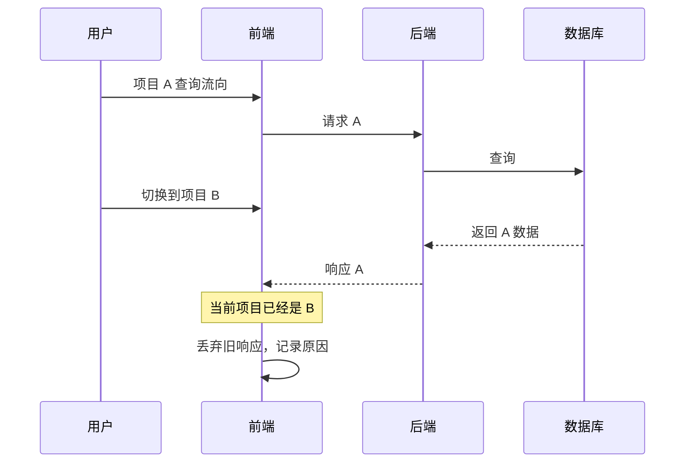

# 动态行为、运行证据与审查

状态：方案；尚未给 Insight 接入 OpenTelemetry、Jaeger 或端到端场景采集。

## 补上时间、状态和因果

静态图提供实体及可能关系；行为模型提供条件和允许的状态变化；运行记录提供某次执行证据；独立断言判断是否符合预期。

重点检查模块组合后的行为：请求倒序返回、切换项目、取消、断连、缓存、新旧数据源混用、关闭对象后的回调。

运行证据用于正常行为基线、issue 复现、修复前后对照和回归验证。视图将一次执行叠加到同版本静态关系上，并允许比较多次执行。并发、队列、重试和订阅可能形成分叉与汇合，需保留因果关系，不能强制压成单条链。

地图还应登记 UI 之外的入口，例如后台任务、定时器、文件变化和外部事件；具体有哪些入口，以源码核实结果为准。每次运行保存影响路径选择的配置、数据源、构建与环境标识。

## 已有源码锚点

在固定的 Insight 版本中：

- `modules/framework/src/centralServer/websocket/connection.ts:246` 起处理响应，并检查请求所属项目与当前项目是否一致；旧项目响应可能被丢弃。
- `server/msinsight/src/base/ModuleRequestHandler.cpp:31` 起有过期请求过滤；响应还保留 requestId 等关联字段。

这说明“数据库成功”与“界面采用结果”之间存在状态条件。本研究尚未证明所有入口都满足完整的过期响应保护，也没有把某个潜在问题当成已复现 bug。

## 最小场景：查询中切换项目

验证预期：A 的迟到响应不能污染 B 的界面。测试应明确观察前端状态/展示结果，不能仅检查后端返回成功或没有异常。

## 采集边界

先记录 UI 操作、发送/接收消息、模块分发、数据库调用、响应采用或丢弃。选择关键状态决策点，而不是无差别记录所有函数。

每次执行关联：场景 ID、代码版本、trace/span/因果关系、业务请求 ID、模块与命令、数据源和项目上下文、实际实现、缓存/取消/过滤决定、结果摘要与源码锚点。

现有业务 requestId 可以帮助关联，但可能在不同层转换或重置，不能直接假定全局唯一。异步队列和 C++ 线程池需要显式传递上下文；不能只按时间相近拼接关系。

使用 OpenTelemetry 的上下文传播和 span links；自定义协议需要接入。它不会自动记录所有业务函数、全部状态或所有 SQL。前端 Playwright trace 和后端 trace 也需要场景/追踪标识关联。

运行记录只代表该版本、场景和采集范围内的观测。未出现的路径可能未执行、未埋点或未采样，不能直接判定不存在。

## 场景矩阵

| 场景 | 核心检查 | 当前状态 |
|---|---|---|
| 正常查询 | 对应请求结果被正确采用 | 未执行 |
| 快速连续查询 | 旧结果不能覆盖新结果 | 未执行 |
| 查询中切换项目 | 旧项目响应不污染新项目 | 未执行 |
| 关闭/取消 | 失效回调不继续修改对象 | 未执行 |
| 断连、失败、重试 | 终态明确，无重复采用 | 未执行 |
| DB/Text 实现 | 实际路径和业务结果与所选数据源一致 | 未执行 |
| 缓存命中/未命中 | 满足相同业务预期，记录路径差异 | 未执行 |

通过测试环境定向控制延迟、响应顺序、失败和缓存条件。复现记录需包括操作序列、测试数据版本、配置和必要的环境信息；单有 trace 不等于可重放执行。

## 静态与动态对照

- 静态存在但本轮未观察：报告未覆盖或采集未知，不直接删除关系。
- 动态观察到但静态缺失：记录为索引缺口候选，回查源码和埋点。
- 修改后执行路径改变：作为审查线索，根据预期判断是否合理；不强制所有调用序列完全一致。
- 结果改变：使用规范、已有契约与测试断言判定，不能只与可能含 bug 的旧结果比较。

审查循环：变更 → 静态影响范围 → 相关场景 → 运行与断言 → 证据绑定到当前版本。AI 获取证据并辅助分析，自动断言负责重复执行检查。

## 与历史问题资产和契约协作

从历史问题读取触发条件、适用版本、预期行为和回归场景，关联到接口、状态和源码锚点；从变更出发沿关系图找到相关资产，再运行能够执行的验证。没有可执行断言的契约保留人工审查状态，不能标记为通过。

运行结果引用资产 ID 和契约版本，并区分问题复现、修复验证和普通回归。旧版本的失败和修复记录保留历史语义，不直接用作当前版本已验证的证明。本研究首期输出关联与结果文件，外部资产库的写回方式另行对接。

## 来源

- [OpenTelemetry traces](https://opentelemetry.io/docs/concepts/signals/traces/)
- [自定义协议上下文传播](https://opentelemetry.io/docs/languages/js/propagation/#custom-protocol-example)
- [Span Links](https://opentelemetry.io/docs/concepts/signals/traces/#span-links)
- [Playwright Trace Viewer](https://playwright.dev/docs/trace-viewer)
- [Hypothesis 状态机测试](https://hypothesis.readthedocs.io/en/latest/stateful.html)
