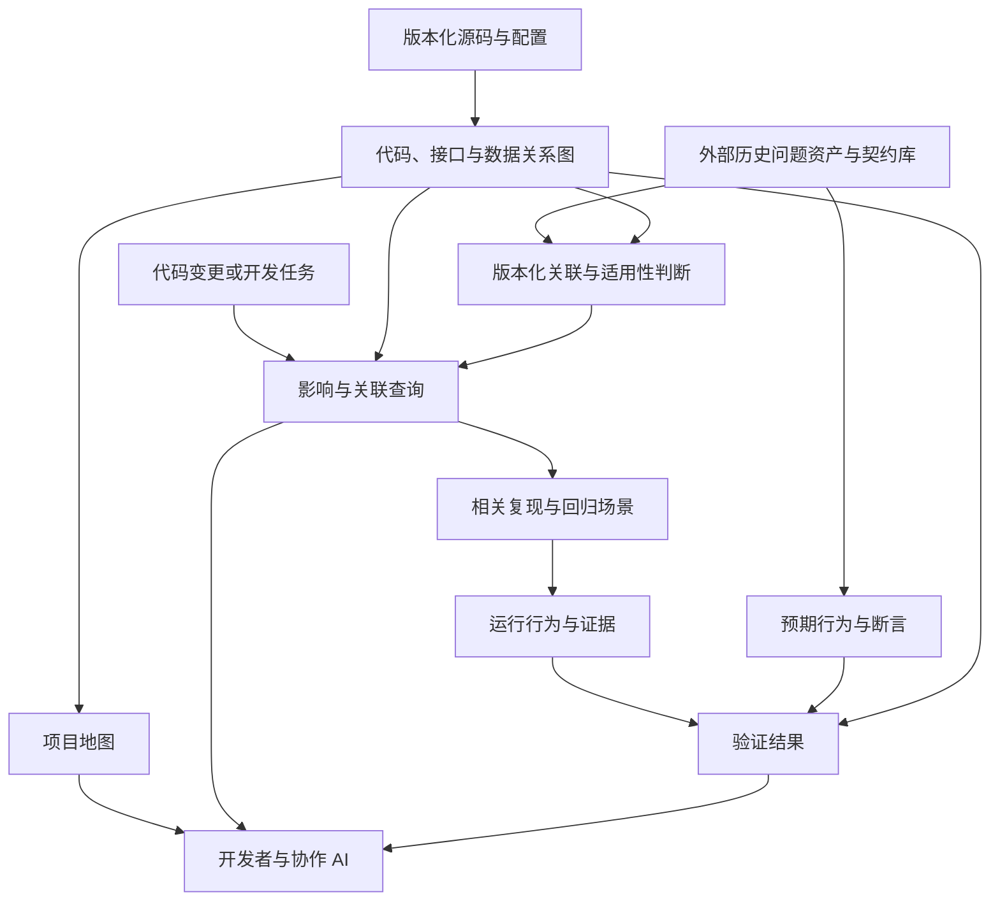

# 设计基线 v0.1：项目模型与历史问题资产协作

日期：2026-10-23。状态：研究范围已确定，实施待启动。后续实验将确定技术选型、交换格式和工作量。

## 目标与使用者

为每个受支持的代码版本自动维护一个项目模型。协作 AI 和开发者能够从业务入口、代码变更或历史问题出发，查询跨模块关系、条件、结果消费者、验证场景及证据缺口。

核心使用过程：修改前理解关联与历史约束，修改中识别影响范围，修改后对照运行证据和独立预期审查结果。AI 通过项目概览和按需查询读取模型，复用已经提取的关系。

首个对象是 MindStudio Insight；参考源码固定提交及人工基准见 [unit/flows](../cases/unit-flows/README.md)。

## 三个视图与共用信息

| 视图 | 必须容纳的内容 | 首期边界 |
|---|---|---|
| 项目地图 | 模块、职责、业务与后台入口、配置、构建范围、外部依赖 | 从被扫描源码形成概览，职责总结绑定证据；未展开部分可见 |
| 代码、接口与数据关系图 | 调用、接口提供/消费、注册、虚接口、共享数据、状态读写、事件订阅和选择条件 | 先贯通 unit/flows，再验证同类规则复用；不声称覆盖所有数据流 |
| 运行行为与证据 | 场景、时序、因果、分支、状态、实际实现、结果和断言 | 正常查询及查询中切换项目；逐步增加其他场景 |

所有视图共用：仓库与 commit、配置/构建标识、提取器版本、证据来源、适用条件、覆盖范围、歧义和未解析原因。

静态图允许条件和候选实现；运行证据只代表已执行且已采集的范围。动态出现而静态缺失的关系进入核查清单。无边、未解析、未执行和未采集必须分别表达。

## 历史问题资产与契约库如何配合

历史问题库总结以往修改中的触发条件、症状、根因、修复和回归要求；契约描述需要持续满足的预期或约束。它们由其他工作维护，本研究提供关联与查询能力。

需要支持四个方向：

1. 从变更找到相关业务链、共享资源、历史问题、契约和验证场景。
2. 从问题或契约找到当前代码锚点、影响链、适用条件和定位缺口。
3. 从一次复现找到静态路径、状态决策、问题资产及断言结果。
4. 从修复后的版本查看关联是否更新、哪些回归已经验证、哪些仍待验证。

对接使用稳定资产 ID、资产修订号、来源引用、适用范围和目标选择器。接口身份、符号签名、资源/字段及场景可作为选择器；行号作定位提示。符号改名后，缺少明确迁移依据的关联标为候选或悬空。

历史发生版本、修复版本与契约当前适用范围分别记录。修复完成后，契约继续按其有效范围判断；未匹配结果附带已接入资产的搜索范围。来源库不可用时显示过期或不可用状态。

首期按对方现有格式，通过只读导出文件或接口接入。资产维护方负责内容，本研究保存关联与验证结果。示范记录明确标为设计样例。

## 自动提取与 AI 的分工

语言索引、协议规则、注册解析、数据关联、更新和检查优先采用可重复的程序。框架适配描述通用机制，例如如何从请求封装和注册表提取接口；具体接口由规则扫描源码生成。

AI 可辅助总结职责、研究规则、提出候选关系和解释证据。AI 候选独立标记，未核实前不升级为确定关系。查询必须能返回源码依据、候选条件和覆盖缺口。

## 第一阶段的成功条件

- 从 getUnitFlows 查到有作用域的接口身份、注册处理器、数据库接口和候选实现，再查到已核实的返回字段与前端状态消费者。
- 从数据库实现或字段反查相关前端入口，并列出未解析的传播步骤。
- 删除注册、修改命令、变更实现后，关系按源码更新；旧关系清理，失配可查询。
- 增量维护与相同输入的干净重建在语义上等价；如果首版只支持全量重建，明确标注，不宣称已支持增量。
- 将一个外部问题/契约引用关联到接口、状态和场景，查询提供版本与适用性。
- 正常和迟到响应两个受控场景有可关联的执行记录与独立断言；运行验证尚未完成时保持未验证状态。

这些条件用于验收后续原型。现有工具的能力与缺口见 [早期实测](../research/experiments/2026-10-23.md)和 [CodeGraph/code-map 实测](../experiments/2026-10-23-unit-flows/README.md)。

## 首版实施边界

- 复用现有语言解析、图存储、查询和追踪组件，开发项目机制适配。
- 首期验证 unit/flows，随后增加两条真实链路；按参考关系和覆盖清单验收。
- 历史问题和业务契约由资产维护方管理，本工具负责技术关联与查询。
- 优先交付可靠事实和查询入口，再完善交互展示。
- 本轮交付设计与计划，技术实现按阶段推进。

## 尚需决策

底座选择与 C++ 解析路径、协议扩展入口、跨版本符号身份、资产库交换格式、动态场景环境与数据，以及有限范围的验收基准。每项应有实验和退出条件，再决定下一步投入。
