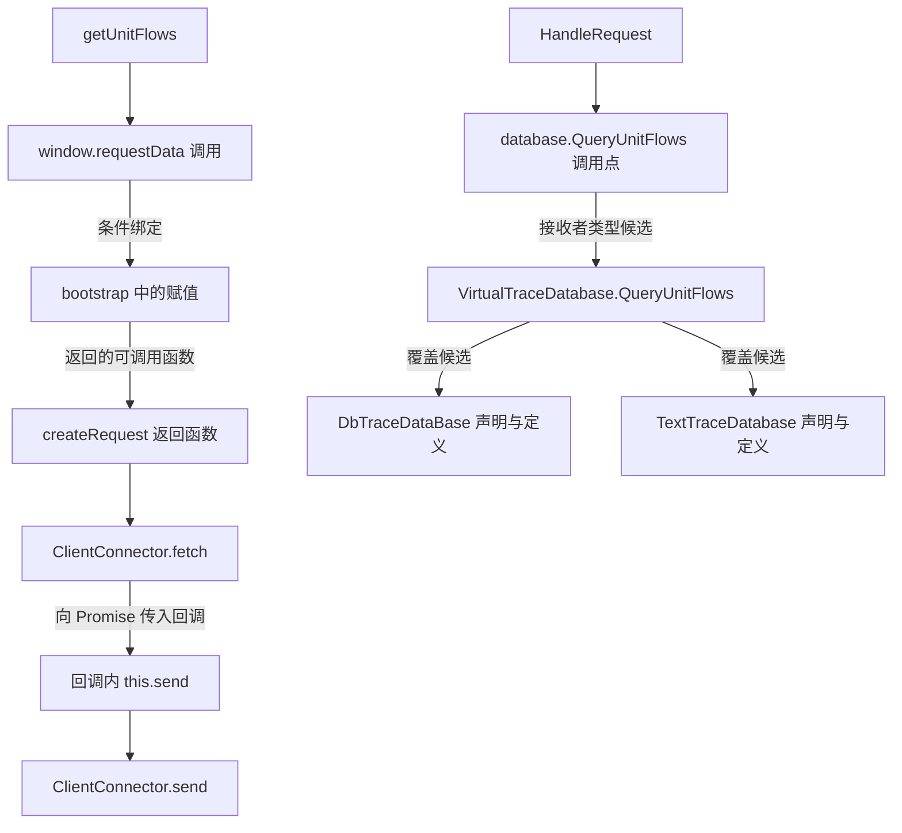

# P1 完成：必要事实、候选关系与底座选择

2026-10-23，**F01–F05 通过，P1 完成**。选定 **CodeGraphContext（CGC）为主底座**，复用 Kuzu 存储；TypeScript 编译器和 Tree-sitter 补充原生提取的缺口。CodeGraph 的 SQLite 扩展也已实测可用，保留为替换方案。P2 接续协议发现与注册关联。

输入为 MindStudio Insight 提交 `d4e8d1cf9f90208bcbe5371c127088f6fd66c688` 的 **65 文件**：22 TS、5 TSX、17 H、13 CPP、8 JSON，另有三工具共用的 3 个合成样例。沿用[上一轮固定输入与原生对照](../2026-10-23-p1/README.md)，本轮新增可执行适配、查询与最终验收。

## 已经可以查询什么

以下路径由源码提取后写入数据库，再从数据库读回评分；图生成过程没有输入案例答案。完整节点、位置、边类型和依据见[执行证据](evidence/completion.json)。

这两段均支持反向查询。前端绑定保留“该赋值在同一运行作用域中有效”的条件；回调边表示函数被传入，执行取决于被调用方。后端两个实现同时保留为候选，实际选中者仍为未知。前后端协议连接归 P2，数据库选择条件和返回字段传播归 P3。

## 验收结果

| 门槛 | 结果 | 执行证据 |
|---|---|---|
| F01 输入与覆盖 | 65 个文件逐项登记；配置、缺失依赖、语法错误和不支持扩展名有状态 | completion 的 coverage/diagnostics；覆盖及错误样例测试 |
| F02 C++ 事实 | 头文件声明、纯虚接口、两个类外定义及命名空间可识别；调用未知有原因；同名/重载反例无确定错连 | 真实 Handler→虚接口→DB/Text 路径；[共用样例](evidence/fixtures.json)；16 项 C++ 测试 |
| F03 TS 事实 | 泛型、覆盖方法、工厂返回函数、全局绑定和回调可追溯 | getUnitFlows→send 正反向路径；13 项 TS 测试 |
| F04 扩展维护 | 两种原生库副本均完成有向关系及完整 JSON 往返、替换、删除、恢复和快照隔离 | completion 的 lifecycle/direct_database_queries；[CodeGraph 独立试验](codegraph-storage.md) |
| F05 参考独立性 | 构图只读源码、manifest 和语言组件；案例断言在生成后执行 | [构图入口](../../scripts/build_fact_graph.py)、[独立评分器](score_graph.py)及输入依赖检查 |

自动图共 **9,031 节点、8,580 条关系**。6,413 个调用点中，337 个有 TS 静态声明目标，14 个有 C++ 接收者类型候选，16 个有条件绑定，6 个有多赋值歧义，6,040 个未解析。该数量描述本轮切片覆盖，不能当作全仓调用召回率。生成的图可以由[查询命令](../../scripts/query_fact_graph.py)直接读取。

本地 **56 项 Python 测试、13 项 TypeScript 测试**通过；CI 执行同一测试集，并检查公开证据的结构和文档链接。数据库测试还验证中途失败回滚、平行边、来源/条件保留及其他快照不受删除影响。实际 CGC 库的 790 条原生 Function 记录、CodeGraph 的 728 节点与 883 边保持原值。

## 组件选择及各自贡献

| 组件 | P1 实际贡献 | 决策 |
|---|---|---|
| CGC 0.6.13，`93c9685bff9151f50a3121e9913e5ba2d27c1191` | 原生保留关键 C++ 类外定义；此前源码位置关联、本轮 Kuzu 图关系维护均通过 | 主底座；保留原生结果，新增事实使用自有表 |
| CodeGraph 1.39.0，`7bac941c1916d34fae0e93dd0ffeaef360d741fb` | 原生 TS 类归属较好；SQLite 自定义表可被原版 SQL CLI 查询，完整图维护通过 | 可替换底座；原生 `.h` 分类、限定定义及声明缺口仍需外部补充 |
| CBM 0.12.1 | 导航和原生查询对照；已暴露重载合并与同名误连 | 保留导航/更新对照，当前调用结果不直接作为确定事实 |
| TypeScript 5.9.3 | `getResolvedSignature` 解析静态声明，包 exports 解析输入内模块；AST 保留泛型、回调和赋值 | 复用现有编译器；绑定与工厂返回关系由小型适配补充 |
| Tree-sitter 0.25.2 / language-pack 1.20.0 | C++ 语法树、范围和错误区域 | 补充声明、继承、签名拼写匹配与接收者候选；不实现 C++ 编译器 |
| Kuzu 0.11.3 / Python SQLite | 保存版本、节点、类型化关系及完整证据载荷 | 两者共用 JSON 约定；P2 主要沿 CGC/Kuzu 推进 |

选择 CGC 的依据是本案例的关键 C++ 原生事实和已完成的集成路径。CodeGraph 的存储能力已过关；切换时可以复用同一补充图。两者的节点总数和本轮耗时不作为综合排名。

自有代码集中在[两个语言适配器](../../adapters/)、[两种存储适配器](../../adapters/kuzu_fact_graph.py)和[有界路径查询](../../adapters/fact_queries.py)。CGC 原生事实仍在原表；新关系进入 `PMGraph*` 表。CodeGraph 对应 `pm_fact_*` 表。原生 `trace` 未自动识别扩展节点，统一 AI 查询接口在 P7 接入。

## 当前能力边界和后续依赖

- **C++ 编译上下文**：本轮恢复语法事实和候选关系，足够满足 F02 的“必要定义、接口、类型身份、候选及未知”门槛。预处理未求值，别名未全面展开，重载未经过编译器证明。真实 SCIP 路径尚未执行；构建配置准备见[此前审计](../2026-10-23-p1/selection.md)。
- **TS 分析上下文**：使用记录在证据中的固定分析配置，包边界作为绑定作用域假设。输入闭合，仅额外加载 TS 标准库。8 个 JSON 中 package exports 用于解析，其他配置登记但未应用；549 条语义诊断、153 个输入外模块、148 个输入外 C++ include、4 条 C++ 解析诊断均保留。该结果覆盖必要路径，不等于产品全量类型检查。
- **更新与性能**：目前是显式全量提取和快照替换。全仓规模、自动触发、原生 reindex/autoheal 对扩展表的影响及失败追赶属于 P4。
- **运行与资产**：本机尚未构建运行真实 Insight，也没有接入团队的真实历史问题资产。P5 需要官方构建依赖和可共享最小数据；P6 按[详细计划中的交换约定](../../plans/implementation-plan.md)对接资产 ID、修订、源码锚点、条件和验证记录。这两项为后续阶段输入。

完整图、原生数据库、第三方源码和环境留在仓库外；公开仓库保存紧凑证据、代码和复现方式。遵从用户要求，本轮后半程及日常 CI 不再重新核验文件哈希，版本以 Git 提交和工具版本记录。

## 复现与检查

见[复现步骤](reproduce.md)。三个原生工具的对照保留在上一轮报告；[CodeGraph 独立存储证据](evidence/codegraph-storage.json)由独立上下文、独立输出目录生成，完成后由主协调者汇总。智能体未读取彼此中间结果；共享文件系统提供流程隔离。
