# P2：自动提取协议身份与跨语言连接

**P2 的 L01–L06 在选定源码与机制范围通过。** 从 TypeScript 入口到 C++ 处理函数的三条请求可正反向查询。名称、字段转换、命令值和注册目标由源码提取；部署配置只声明哪些源码目录属于同一逻辑服务。

证据类型：实际执行源码提取、合成正反例及 CGC 原生数据库副本试验。源码版本为 Insight `d4e8d1cf9f90208bcbe5371c127088f6fd66c688`；提取规则冻结于研究仓库提交 `b4b7492`。输入 [133 文件清单](input-manifest.json)，结果 [completion.json](evidence/completion.json)，操作见 [复现说明](reproduce.md)。未重新核验文件哈希。

## 查到了什么

| 前端入口 | 源码提取的协议命令 | 对应 C++ 处理函数 | 查询结果 |
|---|---|---|---|
| getUnitFlows | unit/flows | QueryFlowsBySliceInfoHandler::HandleRequest | 正向、反向通过 |
| queryTimelineOffset | timeline/rankOffset | RankOffsetHandler::HandleRequest | 正向、反向通过 |
| createCurve | create/curve | CreateCurveHandler::HandleRequest | 正向、反向通过 |

三条请求均提取到报文字段 `moduleName = timeline`。`module` 经参数传递、对象构造变成 `moduleName` 的过程保存在消息节点的 `flow_evidence`。后端独立提取常量、工厂组件、协议与处理器注册表、JSON 键读取、请求成员写入和处理器分发。

```mermaid
flowchart LR
    A[getUnitFlows] -->|EMITS_MESSAGE| B[请求上下文与报文]
    B -->|MATCHES_REGISTERED_PROTOCOL| C[timeline / unit/flows 注册]
    C -->|DECODES_MESSAGE| D[ToUnitFlowsRequest]
    D -->|DISPATCHES_REGISTERED_HANDLER| E[注册的处理器实例]
    E -->|RESOLVES_HANDLER| F[QueryFlowsBySliceInfoHandler.HandleRequest]
```

每个请求拥有自己的协议阶段节点。公共发送器作为源码证据保留，协议查询沿请求上下文遍历。三条请求之间的六种交叉组合，在正反两个方向都没有串到其他处理器。

## 通用性如何验证

提取器采用语言与库机制规则：TypeScript 符号、参数、闭包、对象字段、标准消息 API；C++ 常量、注册表、对象工厂、继承与 RapidJSON 字符串访问。项目函数名、变量名、类名、业务命令和字段名均来自输入。

合成样例验证了：批量改名后仍能连接；内部成员名和 JSON 键名不同仍能追踪；导入别名和解构别名可传值；动态覆盖、未知修改函数、分歧返回值不会沿用旧常量；同命令不同服务或模块保持隔离；未知作用域保留候选；删除提供方、重复注册和多个绑定分别报告未匹配或歧义。

最终规则提交后，从新目录重新构图，评分程序随后检查第二条和第三条真实接口。评分程序持有预期名称；构图程序不读取评分程序或人工 reference。相同机制的复用已验证，跨技术栈覆盖仍按机制扩大。

## 验收与覆盖

| 检查 | 执行证据 |
|---|---|
| L01 消费身份 | 从调用、绑定、封装到报文，保留字段值、传值位置和运行条件 |
| L02 提供身份 | 独立提取 37 个解码器/处理器注册组合，保留工厂、作用域与分发依据 |
| L03 双向路径 | 三条真实请求均形成五段有向关系，并完成反向查询 |
| L04 服务与模块隔离 | 两服务同命令、同服务不同模块及公共发送器负例通过 |
| L05 未匹配和歧义 | 删除提供方、动态命令、未知作用域、多候选与多绑定通过 |
| L06 机制复用 | 冻结规则后，同一次独立构图恢复另外两条真实请求 |

总图包含 **10,367 节点、12,443 关系**，其中 64 条为 P2 协议关系。22 个绑定调用的结果为：3 个有条件匹配到处理函数、12 个候选缺少处理函数体、1 个未匹配、6 个绑定歧义。逐项原因保存在证据中。这里的 22 是所选输入中发现的调用数，不是全仓接口数量。

**74 项 Python、22 项 TypeScript 测试通过。** 在 CGC/Kuzu 数据库副本中完成完整载荷往返、存储后正反查询、替换、删除与恢复；790 条原生 Function 记录保持原值。

## 条件与后续范围

连接结果统一标为 `conditional`。它要求消息到达配置中的逻辑服务、注册生效、请求通过校验和过滤。C++ 类型、工厂归属及引用写入采用源码候选；编译宏、真实插件生命周期、实际 host/port 和线程调度尚未执行验证。JSON 字符串访问采用明确的 RapidJSON 适配，字段写入摘要保留条件；异常、循环、反射和任意传输机制尚未完整建模。

当前输入由 manifest 选定，通用规则不会自动扩大到整个仓库。P3 继续验证数据库选择、返回字段与消费者；P4 负责随提交自动刷新和跨文件失效；P5 接入运行证据。P2 的改名测试验证重建后的识别能力，自动触发和跨版本身份迁移留在 P4。

实现复用 P1 的 TypeScript 编译器、Tree-sitter 事实和 Kuzu 存储，新增协议值传播与作用域连接。无需运行 Insight、启动图形服务或调用 AI 模型。
