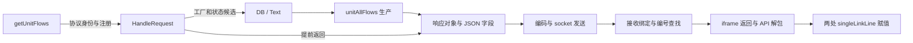

# P3 完成：首链、返回字段与反向影响

**D01–D05 在固定 Insight 提交的 154 文件范围内合并验收通过。** `unit/flows` 可从前端 API 查到后端处理器、DB/Text 候选和字段生产，再经序列化、socket、iframe 与 API 解包查到两处前端状态赋值；数据库方法与返回字段均可反查相关入口。统一查询同时返回源码条件和未展开步骤。

执行证据：[combined.json](evidence/combined.json)。源码提交 `d4e8d1cf9f90208bcbe5371c127088f6fd66c688`；输入沿用 [154 文件清单](server-channels-manifest.json)。实现提交 `14f0897`，统一报告的存储顺序修正为 `cafac29`。图快照为 `p3-data-v13`，共 **24,989 节点、35,445 条关系**。解析器为 tree-sitter 0.25.2、tree-sitter-language-pack 1.20.0，TypeScript 5.9.3。

## 统一查询输出

[chain_queries.py](../../adapters/chain_queries.py)组合已提取的协议身份、对象传递、字段来源、回调编号和连接来源。它从指定返回字段的生产调用记录选择数据库候选，不内置业务方法名。正常与提前返回路径分别保留来源，运行时选择仍由条件表达。



上图压缩展示查询中的阶段，具体边包含协议、候选调用、字段来源和异步交付等不同类型。机器结果含 **373 条分阶段关系、589 个源码依据**，每条关系都能定位到节点与源码。`--details` 可展开各底层查询的原始结果。

| 门槛 | 本次检查 | 结果 |
|---|---|---|
| D01 数据库候选 | 处理器到 DB/Text 两个实现，三个连接池来源、选择条件和数据类型状态 | 通过 |
| D02 返回字段 | 七处生产位置、响应对象、序列化、四个响应出口、socket/iframe/API 和两处字段状态赋值 | 通过 |
| D03 反向影响 | 两个数据库实现各反查前端 API；两处字段状态各反查四个响应出口 | 通过 |
| D04 间接耦合 | 同一静态管理器实例的数据类型写入与读取，正反向查询及作用域/实例负例 | 通过 |
| D05 路径说明 | 十二类阶段、版本、关系类型、源码依据、条件、预算状态与未展开步骤 | 通过 |

## 编码与队列的处置

Windows 编码转换已通过输出缓冲区接回返回字符串。[库模型](../../adapters/cpp_encoding.py)跟踪 `std::make_unique<T[]>`、指针别名、两次 Win32 输出写入和 `std::string` 复制；未知缓冲区修改会清除旧来源。模型要求可见的 SDK include，并排除同名源码声明或宏。四个响应出口各有四条带条件的发送路径，共 **16 条**。

模型依据为 2026-10-23 查阅的 Microsoft [MultiByteToWideChar](https://learn.microsoft.com/en-us/windows/win32/api/stringapiset/nf-stringapiset-multibytetowidechar) 与 [WideCharToMultiByte](https://learn.microsoft.com/en-us/windows/win32/api/stringapiset/nf-stringapiset-widechartomultibyte) 文档：长度查询调用与输出写入分开处理，转换成功、输入编码、有效长度和输出容量作为关系条件。产品二进制的 SDK/系统版本和字符转换结果留待运行验收。

[常量条件提取器](../../adapters/cpp_source_conditions.py)从成员声明和构造函数恢复 `const bool`，再匹配实际接收对象上的条件读取。当前源码的 `useResponseQueue = false` 在三个使用位置均得到关闭结果，因此首链采用直接响应发送。构造器覆盖、不同构造器值、可变成员、局部遮蔽和聚合初始化会改变结果或保留未知，应用开关名未写入规则。

## 验证与证据边界

**237 项 Python、76 项 TypeScript 测试通过。** 编码负例覆盖只查询长度、换输出缓冲区、指针别名修改、缺失 SDK include 和同名函数；常量条件覆盖改名、构造覆盖、分歧、遮蔽与取反。合并查询再验证删除协议桥和查询无关字段不会生成完整关联；此前六组返回断链负例同时重跑。

完整 v13 图写入 CGC/Kuzu 副本并读回后，D01–D05 全部重新执行，结果一致，790 条原生函数记录保持一致。首次读回揭示报告证据编号依赖字典顺序，修正为稳定遍历；公开证据压缩器也增加了字典与引用列表的区分（`63af23a`）。两项修正均有回归检查，整链导出再展开后内容一致。

本阶段交付选定源码范围的条件关系。结果中明确列出：请求消息缓冲区的内部拆帧与工作线程调度、完整路径约束求解、编码检测算法与外部 API 失败分支、输入范围以外的消费者。真实执行顺序、服务地址对应、连接生命周期、旧响应采用/丢弃及数值断言由 P5 验证；全仓扩大另按计划检查。

## 第三条链与后续阶段

已登记 [Memory/view/memoryUsage](../../cases/memory-usage/README.md) 作为 P7 第三条真实链，覆盖 memory 前端、timeline 数据库管理、缓存和图表状态。登记内容为人工参考，P7 在规则冻结后保存首次自动提取结果，再评价复用与新机制。

P3 完成后进入 P4：提交触发的全量刷新、原子发布、失败保留上一成功快照、连续变更追赶及版本差异。P5 真实运行、P6 外部历史资产和 P7 项目地图/AI 验收继续按原计划推进。

## 复现与查询

从研究仓库根目录运行。`SOURCE` 为固定 Insight checkout，`BASE` 为 [返回增量](return-bridge.md)的 v12 图；`OUT`、`STORE` 为新的仓库外目录，`CGC_DB` 为已关闭的原生数据库。环境配置见 [P1 复现](../2026-10-23-p1-completion/reproduce.md)。

```sh
python scripts/build_chain_closure_graph.py --source "$SOURCE" --base "$BASE" --output "$OUT"
python scripts/query_data_graph.py "$OUT/graph.json" --chain-provider 'provider:registry:cdb1a04ef30726dc964f3a66:registry:8cc84bafd0ccae7c02b7357d' --field-path '["unitAllFlows"]'
# 增加 --details 展开各阶段查询；单独反查继续使用 --return-provider 与 --frontend-state。
python -m unittest discover -s tests -v > "$OUT/python-tests.txt" 2>&1
npm test > "$OUT/typescript-tests.txt" 2>&1
python experiments/2026-10-23-p3/run_combined.py --graph "$OUT/graph.json" --cgc-db "$CGC_DB" --output "$STORE" --python-log "$OUT/python-tests.txt" --typescript-log "$OUT/typescript-tests.txt"
python scripts/check_p3_completion.py
```

提供方 ID 从生成图选择。构图不读取人工参考，不重新核验文件哈希。
