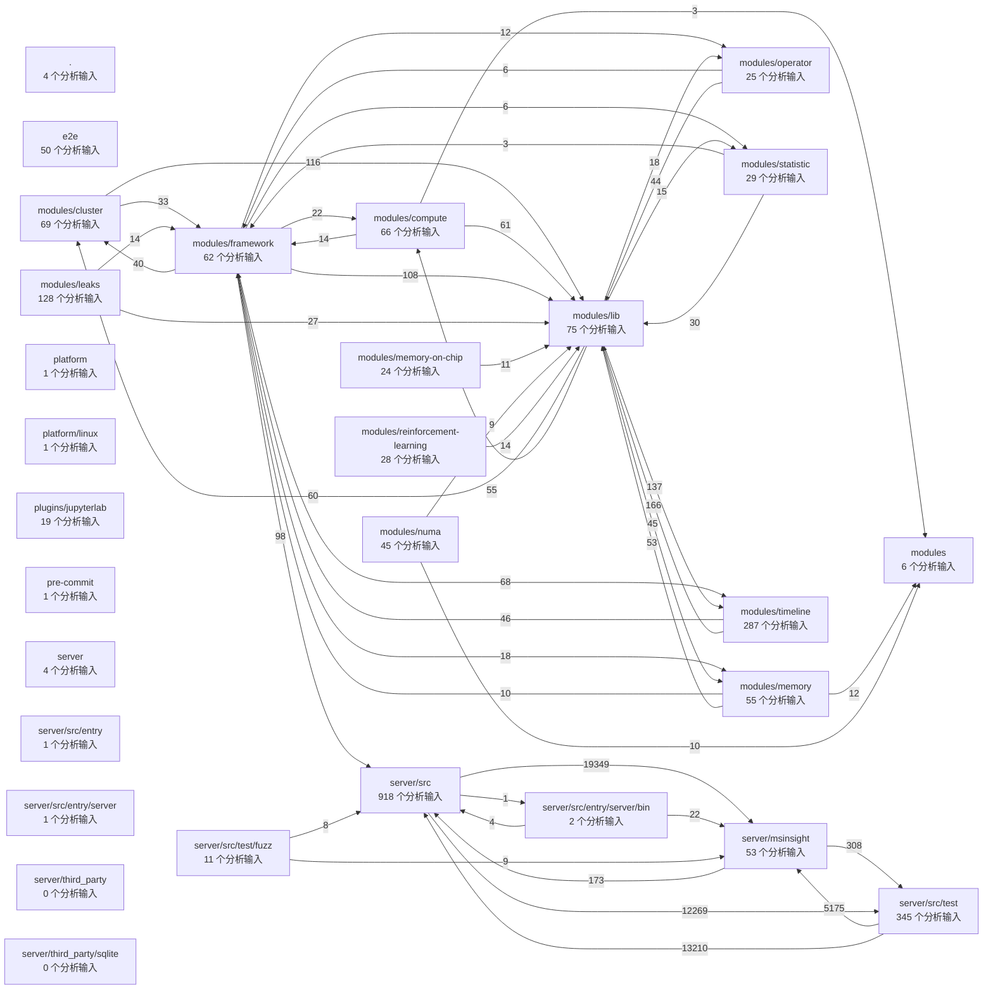

# 自动生成的项目地图

来源：已执行的 A3 查询；模块按最近受版本控制构建清单归属。

源码提交：`d4e8d1cf9f90208bcbe5371c127088f6fd66c688`。快照：`d4e8d1cf9f90208bcbe5371c127088f6fd66c688:full:db2898b7ae2d485d899b2775fe68eb31`。

图中连线汇总跨模块的源码关系与条件候选；箭头沿事实边方向，数量包含不同关系类型和平行边。

| 模块 | 受版本控制文件 | 分析输入 | 源码实体 |
|---|---:|---:|---:|
| `.` | 1930 | 4 | 0 |
| `e2e` | 288 | 50 | 5273 |
| `modules` | 27 | 6 | 23 |
| `modules/cluster` | 73 | 69 | 5149 |
| `modules/compute` | 77 | 66 | 2769 |
| `modules/framework` | 69 | 62 | 2960 |
| `modules/leaks` | 145 | 128 | 13277 |
| `modules/lib` | 159 | 75 | 4555 |
| `modules/memory` | 59 | 55 | 3829 |
| `modules/memory-on-chip` | 28 | 24 | 262 |
| `modules/numa` | 53 | 45 | 937 |
| `modules/operator` | 30 | 25 | 679 |
| `modules/reinforcement-learning` | 32 | 28 | 209 |
| `modules/statistic` | 33 | 29 | 536 |
| `modules/timeline` | 375 | 287 | 18077 |
| `platform` | 23 | 1 | 0 |
| `platform/linux` | 1 | 1 | 0 |
| `plugins/jupyterlab` | 33 | 19 | 521 |
| `pre-commit` | 3 | 1 | 0 |
| `server` | 10 | 4 | 0 |
| `server/msinsight` | 53 | 53 | 4867 |
| `server/src` | 919 | 918 | 109058 |
| `server/src/entry` | 1 | 1 | 0 |
| `server/src/entry/server` | 1 | 1 | 0 |
| `server/src/entry/server/bin` | 2 | 2 | 71 |
| `server/src/test` | 415 | 345 | 98357 |
| `server/src/test/fuzz` | 12 | 11 | 328 |
| `server/third_party` | 1 | 0 | 0 |
| `server/third_party/sqlite` | 3 | 0 | 0 |

逐层查询命令见 [A3 使用说明](../README.md)。无分析输入的模块仍保留在地图中，具体排除理由由 files 查询给出。
