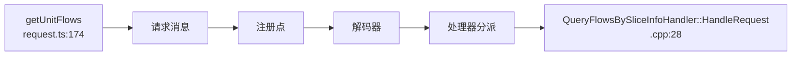

# 给 AI 的逐层查询流程

本页使用 A3 已执行的 getUnitFlows 回归说明查询方式。每条查询读取同一个本地 SQLite 索引，输出带源码提交、图版本和导航版本的 JSON。索引构建和预算参数见 [README](README.md)。

## 先定位模块与处理范围

```sh
python scripts/project_map.py query --index <map.sqlite> overview --limit 10
python scripts/project_map.py query --index <map.sqlite> links --module modules/timeline
python scripts/project_map.py query --index <map.sqlite> files --module modules/timeline --limit 20
```

概览中的 `graph_inputs` 是模块进入图的输入数，`source_statuses` 给出处理状态。`files` 也返回未进入图的文件及原因。沿 `next_cursor` 取下一页，保持其他过滤条件一致；调整页大小不会改变查询身份。

## 查入口、协议与调用

```sh
python scripts/project_map.py query --index <map.sqlite> entries --name getUnitFlows
python scripts/project_map.py query --index <map.sqlite> status --start getUnitFlows
python scripts/project_map.py query --index <map.sqlite> neighbors --start getUnitFlows --limit 10
```

入口清单给出匹配状态和 message 节点。沿 `EMITS_MESSAGE`、`MATCHES_REGISTERED_PROTOCOL`、`DECODES_MESSAGE`、`DISPATCHES_REGISTERED_HANDLER`、`RESOLVES_HANDLER` 展开，实测得到：



这些边带部署、注册生效、校验及候选类型等条件。完整正反向路径、节点定位和入口源码见[已执行证据](evidence/protocol-witnesses.json)。同名函数存在多个定义时，使用 search 返回的节点 ID 选择上下文。

## 按关系查影响和依据

```sh
python scripts/project_map.py query --index <map.sqlite> path --start getUnitFlows --target <handler-node-id> --depth 8 --kinds EMITS_MESSAGE,MATCHES_REGISTERED_PROTOCOL,DECODES_MESSAGE,DISPATCHES_REGISTERED_HANDLER,RESOLVES_HANDLER
python scripts/project_map.py query --index <map.sqlite> impact --start <handler-node-id> --depth 4
python scripts/project_map.py query --index <map.sqlite> detail --entity edge --id <edge-ordinal> --pointer /conditions
python scripts/project_map.py query --index <map.sqlite> detail --entity edge --id <edge-ordinal> --pointer /evidence
python scripts/project_map.py query --index <map.sqlite> diagnostics --path <repository-relative-path>
```

`neighbors --direction in` 是直接反查，`impact` 在深度和访问预算内沿反向关系展开。不同边类型表示调用候选、值来源或共享资源等不同依赖；检查其类型和条件，再判断修改影响。`detail` 对对象、数组的子项分页；大对象可沿返回的 JSON pointer 继续展开。`value_truncated` 表明该值超过当前单项显示预算。

## 找字段、资源和状态

```sh
python scripts/project_map.py query --index <map.sqlite> search --text unitAllFlows --kind api_result_field
python scripts/project_map.py query --index <map.sqlite> search --text CurveContainer --kind storage_member
python scripts/project_map.py query --index <map.sqlite> search --kind frontend_state_write --module modules/timeline
python scripts/project_map.py query --index <map.sqlite> neighbors --start <resource-node-id> --direction in
python scripts/project_map.py query --index <map.sqlite> impact --start <resource-node-id> --depth 4
```

实测检索到 20 个 unitAllFlows 字段节点、6 个匹配 CurveContainer 路径的 storage_member 节点、41 个 timeline 状态写入节点。这些是源码实体计数，具体语义由节点和关系证据说明。

P7 的 `trace --field` 组合账本继续使用原有入口，见 [P7 完成报告](../2026-10-24-p7/completion.md)。A3 通用邻接图保留 A2 全部节点和边，便于按需检查各段关系。

## 读取对应版本源码

```sh
python scripts/project_map.py query --index <map.sqlite> source --source <Insight-checkout> --start getUnitFlows --context 8
```

源码从索引记录的 Git 提交读取。也可指定 `--path` 和 `--line`；单文件读取上限 2 MiB，显示窗口受输出预算控制。

出现 `stop_reason` 时读取具体原因；`depth_scope_reached` 表示查询已到深度边界。邻接列表可继续分页或从所选节点再展开。未找到路径、未知匹配、未支持语言与运行尚未观察，分别按照输出状态处理。
