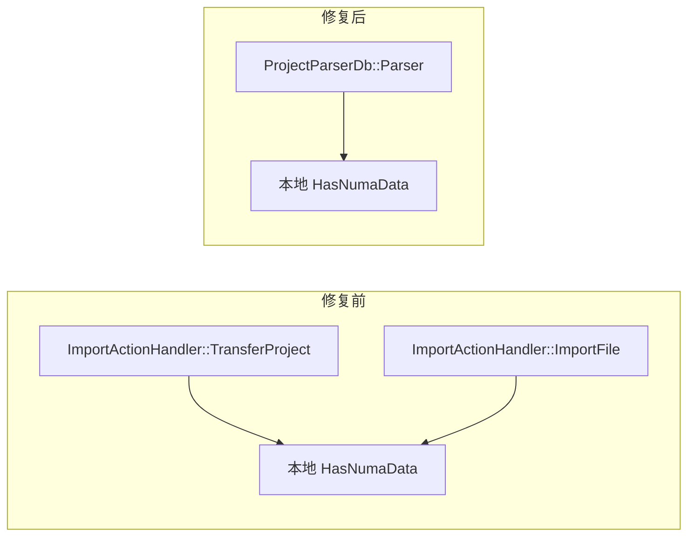

# A4 首轮评估：更新一致性通过，新模块连通性未通过

日期：2026-10-24。评估已执行完成，当前工具未通过新模块连通性和直接传输入口发现的验收。结果见[机器报告](evidence/evaluation.json)。

复核后，六个新模块请求中有 **3 个协议发送端正确匹配预期处理器、1 个显式未知、2 个未匹配**；这三对已返回的匹配中没有错误额外连接。两个预期前端状态的返回关系均未贯通。版本更新、独立重建和既有链回归通过。

## 评估怎么做

先在 `379da8d` 提交[冻结协议](protocol.md)，再于 `bd5d2a8` 提交[原始源码参考](reference.json)。工具基线为 `b85ba0cb3cfc0d89856ce7fed63ca28da705c215`；本轮没有修改提取、连接和导航实现。A2 到该基线的实现新增仅为 A3 的三个地图入口文件，提取逻辑保持一致。

新模块固定为 Cluster、Operator、Leaks，各取源码顺序中的前两个导出请求函数，选择不依赖图的成功与否。六项参考来自源码，输入仍按全仓发现规则生成。A2 已提取过全仓，本轮属于规则冻结后的模块抽查；不宣称源码首次进入工具或严格盲测。

首次评分有两处参考问题和一处分类问题：把前端 cluster 分组当作后端协议作用域，只按导出名称识别入口而漏计匿名回调，并把未匹配归入未知。原始参考及[首次 2/6 输出](evidence/first-chain-results-raw.json)完整保留。随后按 `ProtocolDefs.h:36`、`Request.ts:40` 以及原始请求调用位置形成[复核参考](reference-reviewed.json)，补充[复核评分](evidence/reviewed-chain-results.json)。评分参考修正发生在首次输出之后；两版结果分开保存，未修改提取规则。

## 新模块结果

| 请求 | 协议结果 | 数据生产节点正反查 | 预期序列化字段 | 前端消费 |
|---|---|---|---|---|
| Cluster queryIterations | 显式未知；延迟路径中的 command/moduleName 未恢复 | 前段阻断，未评价 | 未评价 | 未评价 |
| Cluster queryStages | 匿名回调中的发送端正确匹配 GroupHandler | 通过 | data 关系存在 | 返回 helper/导出别名的完整消费路径未确认 |
| Operator queryOperatorCategory | 正确匹配 QueryOpCategoryInfoHandler | 通过 | data 关系存在 | opTypeData 返回状态未连通 |
| Operator queryOperatorComputeUnit | 正确匹配 QueryOpComputeUnitHandler | 通过 | data 关系缺失 | computeData 返回状态未连通 |
| Leaks getBlocksGraphData | 未匹配；预期命令没有提供方候选 | 前段阻断，未评价 | 未评价 | 未评价 |
| Leaks getLeaksAllocationsData | 未匹配；预期命令没有提供方候选 | 前段阻断，未评价 | 未评价 | 未评价 |

三个可进入深层查询的案例均找到预期生产节点的正反向候选路径，两个找到预期序列化字段。四个 helper/Worker 型消费者没有被当成 React 状态断言计分；另两个有明确状态目标的案例为 **0/2**。这些结果共同说明当前模型各段的实际连通范围，不能把“找到 handler”写成完整端到端通过。

[缺口证据](evidence/gap-evidence.json)包含原始阶段事实。queryStages 的协议连接存在于 `<lambda@64:5>`，按导出名直接查入口仍缺少别名映射。Operator 中有响应字段读取和状态重置节点，预期数组映射后的状态更新未连通。Leaks 源码的模板解码注册存在，图中对应命令的提供方候选为零；具体缺失的类型实例化/分派规则需用机制控制进一步定位。

## 更新与可复现性

独立产品副本新增两个自建模块，再提交跨文件命令、函数、文件改名及提供方删除。最终仅五个自建路径改变，产品原有源码保持原提交内容。首次副本曾因行尾转换产生 130 个额外路径变更，该副本在产品提取前排除；正确副本通过禁用 checkout 转换、限定暂存范围和五路径断言生成。

- 全仓输入 **2,310 → 2,315**，结构模块 **29 → 31**，跟踪路径 **4,855 → 4,860**；最终图 **271,837 节点、386,207 边**。
- [刷新控制](evidence/update-controls.json) **13/13**：新增接口、改名、删除、异服务隔离、失败保留旧图、恢复、脏工作区排除及独立重建通过。
- [产品更新检查](evidence/updated-map.json) **9/9**：新输入、符号与提供方出现，旧路径/提供方消失，旧游标拒绝，旧图可读。
- 两个新增直接 socket 发送有底层事实，**协议消费方清单中为 0**。此类入口的新增发现和删除后未匹配提示未通过，未计入上述成功控制。
- [两次完整构建](evidence/full-builds.json)耗时约 **741 秒、764 秒**，采样进程树工作集峰值约 **4.21、4.39 GiB**，均在 1,800 秒/6 GiB 预算内。
- [完整重建比较](evidence/rebuild.json)直接比较全部解析 JSON，仅剔除 `snapshot` 和 `version.snapshot`，内容一致。比较另用 180 秒/10 GiB 预算，实测约 18 秒，工作集峰值约 6.51 GiB；未重新核验文件哈希。
- [控制器大图校验](evidence/publication-validation.json)约 24 秒、4.97 GiB，通过 6 GiB 预算；这是发布前校验成本，未把它写成新的完整提取或发布。

[既有三条链及两条字段链的 19 项回归](evidence/known-regression.json)通过；[完整测试](evidence/tests.json) **334 项 Python、88 项 TypeScript 通过**。测试通过表示已有规则与更新行为保持稳定，新模块中的未连通结果继续保留。

## 12 条历史候选

已按用户本轮 A4 指令启动原保留候选，未改集合归属。12 条均找到修复前一父提交和 master 修复提交，并核查差异；当前固定版本中均能定位修改文件的源码实体。15–18、19–20 及 4/6 分组报告，合为七个相关性分组，见[完整登记](evidence/history.json)。

每条历史记录分别保存原表说法、引入版本线索、修复前后版本、当前图覆盖和运行缺口。当前图对应修复后的源码，**12 条实体可定位不等于 12 条历史缺陷已检出或复现**。本轮没有逐条构建十二对历史全仓图，运行复现数为零。

第 24 条额外在修复前后各提取全部修改的两个 C++ 产品文件，见[双版本事实](evidence/history-pair.json)。自动提取观察到：

该结果确认了通用导入到 DB 专用解析的直接调用迁移。完整下游数据库/缓存链和 TEXT 旧缓存污染尚未在这个双文件范围或运行中验证。

## 结论与下一步

A4 首轮评估材料齐备，工具连通性门槛未通过。优先按[修正与复验计划](repair-plan.md)补齐通用入口、延迟值传播、模板解码及序列化/消费关系，再复验；原六项改为已使用的回归材料，后续新增独立成绩需要新的冻结参考。A5 的运行及资源验证、P6 的真实历史资产接入仍分别推进。

原 GitCode 上游及原始 Insight 下载副本未修改。历史缺失对象仅在 A4 实验副本从 GitCode 取回。首次问题保存在[记录](evidence/first-failures.json)，原始图、日志、补丁及数据库保留在研究 Git 外。
