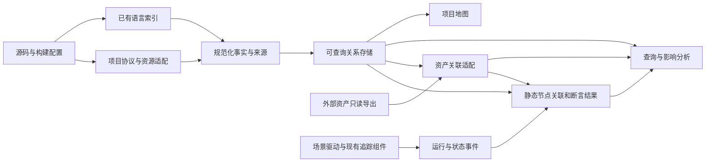

# 项目模型与历史问题资产协作：详细计划书 v0.1

日期：2026-10-23。状态：**P1、P2 已完成，P3 实施中，P4–P7 待实施**。F01–F05、组件选择和复现见 [完成报告](../experiments/2026-10-23-p1-completion/README.md)。范围依据 [设计基线](../docs/05-design-baseline.md)，阶段与工作量见 [总计划](README.md)，检查项见 [验收矩阵](acceptance-matrix.md)。

本文定义整体数据和查询约定。P1 已实现必要事实的 JSON 交换、CGC/Kuzu 与 CodeGraph/SQLite 存储；P2 起扩展协议、资源和运行实体。

## 1. 问题、目标与范围

本计划解决已测工具在 C++ 方法、虚调用、自定义协议、服务身份、返回数据和更新一致性上的具体缺口。证据见 [早期实测](../research/experiments/2026-10-23.md)及 [CodeGraph/code-map 实测](../experiments/2026-10-23-unit-flows/README.md)。P1 已统一输入和配置口径，并完成候选对照。

本项目为 AI 和开发者提供三个共享版本与证据的视图：项目地图，代码/接口/数据关系图，运行行为与证据。历史问题和契约由外部库维护，本项目支持按变更检索约束、按问题展开链路、按场景回查验证结果。

首轮交付研究原型，以固定 Insight 提交上的 `timeline/unit/flows` 为首链，再增加两条真实业务链。至少一条覆盖其他模块，最后一条检验规则冻结后的复用；具体接口在 P2/P3 源码审计后登记。

首期至少覆盖一个响应字段及其状态消费者，并验证一例通过共享数据或状态形成的间接耦合。后台任务、事件、文件变化、复杂 SQL、缓存与外部服务列入扩展检查，按实际机制逐项记录支持情况。

## 2. 已有输入与前置条件

| 输入 | 当前状态 | 后续动作 |
|---|---|---|
| Insight 源码 | 固定提交 `d4e8d1cf9f90208bcbe5371c127088f6fd66c688` | 以清洁 checkout 或可复现补丁作为每次实验输入 |
| 首链基准 | 15 个源码锚点、7 个参考节点、6 条人工关系 | 扩展请求封装、返回字段、条件和资源基准；人工基准只用于评分 |
| 工具证据 | 五组执行结果，另有源码/文档调查 | 保留各自固定版本与限制；重新使用相同输入进行定向能力比较 |
| C++ 构建信息 | 已检查的 tracked 文件无 compile_commands.json | 调查官方构建方式，记录所需编译上下文的生成方法或缺失项 |
| Insight 可运行环境 | 本研究尚未验收 | P1 开始确认构建依赖、启动方式、测试数据、配置及延迟控制位置 |
| 历史问题与契约库 | 团队确认另行维护，交换格式和内容未读取 | 对齐只读导出/接口、稳定 ID、版本和维护联系人，取得真实样例 |
| 运行数据 | 尚未接入真实场景 | 优先最小可共享数据；原始产品数据及大型 trace 在仓库外保存 |

开发工作在独立研究分支或副本进行。公开仓库保存自有适配、可公开 fixture、紧凑证据和引用；第三方 checkout、二进制、数据库、原始 trace 与团队内部资产外置。复用组件时核对固定版本的许可及采用方式。

## 3. 组件边界与复用策略



复用优先级：已有语言提取器/编译器索引、已有存储与查询、已有追踪组件、已有展示。自行增加的内容限于已有试验证明缺失的项目规则、身份规范化、关联、诊断和证据导出。

P1 验证底座导入、查询和清理自定义实体/关系的能力，包括类型、来源和条件。需要独立关联层时，用小型规范化文件连接查询结果，并检查来源 ID、生命周期、跨图遍历和重建一致性。

工具决策只选满足必要门槛的方案：

| 方向 | 下一步要验证的能力 | 达不到门槛时 |
|---|---|---|
| CBM 导航候选 | 必要 C++ 定义、调用目标来源、自定义关系的导入/查询和更新 | 仅保留导航角色，不能输出未经核实的确定调用 |
| CGC / 可用更强索引路径 | 编译上下文可获得性，关键 C++ 方法和虚接口解析，产物是否可导出 | 记录环境或能力缺口，不宣称未测路径已解决问题 |
| CodeGraph | 头文件/限定方法、路由方向、服务作用域、共享节点更新 | 不因有 HTTP 节点就承担 Insight 主链；只复用已通过的部分 |
| code-map | 插件可扩展性及 C++ 事实接入成本 | 不在首期从零补齐整个 C++ 解析器；可借鉴接口关联表达 |
| CoderMind | 可靠事实能否绑定到职责层，语义摘要如何标版本 | 延后完整职责生成；先采用源码绑定的简明地图 |

P1 原版对照包含 CBM、CGC、CodeGraph 三者；独立补充事实在 CGC 和 CodeGraph 两种存储中完成同图维护验证。选用 CGC/Kuzu 作为后续主路线，CodeGraph 保留替换资格。上表中的协议、更新、职责和 SCIP 能力按后续阶段继续验证，具体 P1 贡献与成本见完成报告。

## 4. 拟议事实、版本与证据约定

### 4.1 实体和关系

最小实体包括模块/服务、文件/符号、业务接口、注册项、数据资源/字段、状态、配置、场景/执行和外部资产引用。

关系区分调用、声明/实现、提供/消费、注册/分发、序列化/解码、读/写、字段生产/消费、调度/订阅、候选实现和条件选择。运行事实单独记录，按节点或关系引用静态快照；静态候选集合保留，实际目标标在对应执行中。

业务接口的身份至少包含系统/服务或连接作用域、协议、模块、命令或方法/路径、方向及协议版本。未知服务身份保留多个候选，同名路径按作用域区分。数据库表和缓存键使用连接/数据源或命名空间标识。

### 4.2 每条事实的最小信息

| 信息 | 目的 |
|---|---|
| snapshot、repository、commit、配置摘要 | 确认事实属于哪个可复现输入 |
| 实体身份、关系类型、端点 | 形成有语义的可遍历结构 |
| 路径、符号、位置与校验片段 | 从关系定位到对应源码 |
| 提取器/规则版本与输入依赖 | 解释来源并确定变更失效范围 |
| 证据类别与解析状态 | 区分语法/类型事实、规则匹配、静态候选、运行观测和 AI 候选 |
| 适用条件、候选集合、未解析原因 | 保留不能唯一确定的情况 |

快照内实体使用独立 ID，跨快照匹配结合符号签名、模块和来源，行号用于源码定位。重命名映射无法确定时输出候选。

证据来源与解析状态分别记录，例如来源为“规则匹配”、解析状态为“有歧义”。置信度可作为补充字段。

### 4.3 覆盖与诊断

必须有文件总清单，以及已解析、过滤、不支持、解析失败的数量与原因。接口清单分消费、提供、唯一匹配、多候选、未匹配；已提取调用分已解析、候选、未解析。

各指标注明分母：调用解析率以已提取调用为分母，召回率以独立人工参考样本为分母。运行覆盖分别统计场景执行、采集完整性和断言执行。

## 5. 分阶段工作包

### P1：必要事实与底座门槛

当前：**完成，F01–F05 通过**。统一 65 文件 + 3 fixture；关键声明、命名空间、类型候选、TS 静态调用/绑定/回调以及两种真实库副本维护已验证。56 项 Python、13 项 TS 测试通过。主底座 CGC/Kuzu，证据、原生/适配贡献和能力边界见 [完成报告](../experiments/2026-10-23-p1-completion/README.md)。

输入：固定源码、首链参考、最新两轮工具证据。产物：必要能力清单、共享源文件 manifest、工具配置、原生输出、规范化差异和决策记录。

步骤：

1. 扩展首链参考到完整请求封装与返回消费者，逐项标明源码已核实或仍未知。
2. 为所有候选准备相同真实文件、相同反例和必要构建依赖；现有 42/46 文件切片不能直接作为公平排名输入。
3. 检查 C++ 头文件分类、类外限定方法、纯虚声明、实现、智能指针接收者和命名空间/重载；检查 TS 全局绑定、泛型、覆盖方法和回调。
4. 单独验证自定义节点/关系的导入、方向、证据字段、查询与删除；记录原版能力及自有适配各自贡献。
5. 检查是否需要完整编译上下文；若需要，保存构建命令与配置来源。另行记录上下文不足时的输出限制。
6. 同期确认产品运行环境和历史资产交换方式，为后续依赖做准备。

门槛：目标关键定义/接口及候选实现均可识别；确定的调用有可核实依据；同名负例不产生确定错连；未知调用明确诊断；扩展路径可维护。人工参考仅进入评分，提取器独立读取源码。

预计 3–5 人日。未通过时先交付缺口与限定修复方案，再决定适配投入。

### P2：协议发现、注册与作用域

当前：**完成，L01–L06 通过**。133 文件输入，三条真实请求正反向连接到处理函数；74 项 Python、22 项 TS 测试及 CGC 存储维护通过。函数名、字段名与命令从源码提取，部署配置只绑定逻辑服务。范围、条件与复现见 [P2 完成报告](../experiments/2026-10-23-p2/README.md)。

输入：P1 选定事实层及扩展约定。产物：独立消费/提供清单、接口关联规则、自动链路和未匹配诊断。

步骤：

1. 根据 TS 符号、参数和对象字段传播提取请求身份及来源；名称作为提取结果，追踪请求封装与绑定。
2. 解析 module 到 moduleName 的映射、选择的连接和序列化边界；按请求上下文传播，不沿公共发送器扩散到所有业务。
3. 从 C++ 常量、插件、协议反序列化及 handler 注册恢复提供方；分别保留声明、注册和执行关系。
4. 按作用域和已知身份关联，生成有方向的可遍历关系；匹配不到和多匹配均可查询。
5. 以两个服务同命令、同命令不同模块、缺失提供方和动态命令做反例。
6. 从源码选定第二条同机制接口，冻结规则后运行；具体端点由源码提取，新增规则时记录原因及影响范围。

门槛：unit/flows 正确连接到自己的注册/处理器，两个同名服务不误连，第二条接口证明机制复用。预计 3–5 人日。

### P3：数据库选择、返回数据与影响查询

当前：**实施中**。已增加通用 C++ 容器读写、条件选择、分配与回调来源；前端到两个数据库候选和状态读写关系可双向查询。D01–D05 尚未完整验收，后续缺口与复现见 [P3 实施记录](../experiments/2026-10-23-p3/README.md)。

输入：P2 关系。产物：首链完整静态查询、字段/状态传播记录、间接耦合样例、反向查询和条件清单。

步骤：

1. 连接 HandleRequest、数据库抽象方法、DB/Text 候选实现；登记连接池、工厂、数据类型及 rankId/fileId 路径选择。
2. 对已核实的选择条件建立条件关系；尚未恢复的状态写入保留未知，实际选中结果在 P5 采集。
3. 提取 unitAllFlows 的响应生产、解包、消费和前端状态赋值；区分调用路径和字段数据流。
4. 选择一个真实共享状态或资源，独立核实读写双方及作用域；如真实样例尚未确定，合成 fixture 只证明机制，不计真实案例通过。
5. 查询数据库方法、字段或资源的反向依赖，按关系类型与已知请求身份限制传播；遇到公共连接器不默认返回全仓全部 handler。
6. 登记第三条真实链，覆盖其他模块或资源机制，作为 P7 复用检查对象。

门槛：首链每个必要步骤有自动事实与证据，确定关系不含参考负例；未知条件清单可读；至少一个间接耦合有来源并可反查。预计 3–6 人日。

### P4：版本、刷新与一致性

首版优先完成按提交触发的可靠全量刷新。增量只有在能维护依赖失效和共享实体生命周期时再启用。

步骤：

1. 快照包含源码/配置摘要、工具版本、输入清单和覆盖诊断；脏工作区若被允许则必须携带补丁或内容摘要，不能只标 HEAD。
2. 新快照在临时位置完成构建和检查，成功后整体发布。失败时保留诊断和上一成功快照，last_success 保持不变，当前任务标为失败待处理。
3. 定义变更依赖：常量变化影响其他文件的接口身份，注册删除影响消费关联，实体删除影响契约锚点；工具配置变化也触发重建。
4. 连续提交排队或合并到最新目标；中断、锁冲突或失败后，从最后成功版本追赶到记录的目标版本。
5. 验证新增、删除、重命名、常量改值、跨文件注册、同名实体和配置切换。
6. 若启用增量，对相同最终输入运行干净重建，比较实体身份、语义关系、来源归属、条件和诊断；运行时间及临时 ID 可按明示规则规范化。
7. 旧职责摘要和运行证据保留原版本。资产锚点重定位失败时输出悬空，不继承“已验证”状态。

门槛：自动全量刷新通过必测项；增量未通过则保持关闭并报告。预计 2–4 人日。

### P5：真实运行与状态验证

前置条件：可复现的 Insight 构建/启动、最小测试数据、可控制延迟的位置、P3 静态图。产物：场景说明、运行命令、配置/数据摘要、紧凑 trace/事件、断言结果和静态关联报告。

从已调查的 OpenTelemetry/Jaeger/Playwright 候选中验证接入方案，补充自定义协议、异步队列和线程池上的上下文传播。

最小采集边界：UI 操作、请求封装与发出、服务端接收/分发、数据库调用与实现选择、返回、前端采用/丢弃、最终状态。采用 requestId 辅助关联前，核实其唯一性范围及跨层变化；跨进程因果使用明确的父子或链接标识，时间戳用于辅助展示。

每条运行记录至少保存场景 ID、源码/构建/配置/测试数据标识、业务请求和追踪标识、父子或链接关系、模块/命令、项目上下文、实际实现、状态决定、结果摘要及静态锚点。捕获必要摘要，避免无差别记录原始业务负载。

必做场景：

1. 正常查询：结果与请求和项目对应，前端最终采用预期数据。
2. 查询中切换项目：控制 A 响应晚于切换 B，检查 A 响应不会污染 B 状态，并记录在哪里丢弃或拒绝更新。
3. 断言自检：在测试副本中注入可控错误或迟到更新，确认断言会失败。

动态视图将运行节点叠加到同版本静态关系，保留缺失映射；比较正常与异常运行时允许合法路径差异，由独立预期判断行为。未采样、未埋点、执行未知分别标记。trace 只有在具备场景、数据和环境描述时才构成可复现包的一部分。

正常和项目切换各重复 3 次，保留全部结果，用于检查场景可重复性。竞态覆盖通过扩展时序场景推进，包括快速连续查询、取消、断连/重试、缓存与不同数据源；机制不存在时记录源码审计依据。

预计 4–7 人日，不含获取运行环境和数据的等待。环境不具备时可以完成合成传播实验，但 P5 和 M2 保持未通过。

### P6：历史问题资产与契约的只读接入

输入：P3 可定位实体、P4 版本语义、外部库导出/接口；运行结果连接依赖 P5。产物：只读适配、资产关联、适用性与悬空报告、按问题/变更/场景查询结果。

与资产维护方对齐实际格式，建立外部字段到最小交换记录的映射，缺少的字段标为未知或待完善。

| 交换信息 | 要求与用途 |
|---|---|
| 资产 ID、修订号、来源引用、类型 | 稳定定位历史问题、契约或修复经验；缺版本时记录导出摘要 |
| 历史发生/修复版本 | 描述历史事件，不直接作为当前适用范围 |
| 契约适用条件 | 仓库、代码版本规则、配置/数据源条件、有效状态；不明确时保留未知 |
| 技术选择器 | 接口身份、符号签名、资源/字段、状态、场景；行号作辅助定位 |
| 触发条件和预期 | 由资产维护方提供，用于理解风险和选择验证 |
| 复现与回归关联 | 场景 ID、断言/测试引用；缺可执行项时返回人工审查待办 |
| 内容引用和必要摘要 | 遵循来源可见范围，研究仓库只发布可公开部分 |

关联流程：解析选择器 → 按快照定位候选 → 判断适用条件 → 保存证据与状态 → 支持双向查询。技术定位与适用性分别记录，状态包括明确适用、候选相关、条件未知、不适用、悬空和来源过期。

版本适用性使用显式提交集合、祖先关系、分支/版本规则或维护方提供的判断，禁止按 SHA 文本大小比较范围。重命名和分支合并后的约束迁移需要明确身份依据，近似名称匹配保留为候选。

变更查询返回受影响事实、关联资产、适用条件、建议场景与已有结果。未匹配时显示“在当前已接入范围内未找到”。外部库不可用时保留最近成功导出及其时间/摘要，查询显示过期状态。

至少接入一条维护方提供的真实历史资产。接口就绪前可用标为 synthetic 的记录开发适配，真实对接在 H01 验收。首期导出本地关联/验证结果；原库写回作为后续对接项，另行明确责任和权限。

预计 2–4 人日；格式确认可提前，具体真实资产内容依赖维护方。

### P7：项目地图、查询入口和复用验收

产物：带范围声明的项目地图、统一查询入口、机器可读结果、运行/资产关联视图、复现指南和验收报告。

地图按模块和功能组织，职责总结绑定代码实体和生成版本；先用结构化事实及简短说明，LLM 总结可选。若使用 LLM，记录模型、提示、输入版本和成本；未经核实的概括与事实层分开。

优先复用已有 CLI/MCP，按以下语义设计查询：

| 查询 | 输出 |
|---|---|
| overview(scope, snapshot) | 模块与职责入口、外部依赖、覆盖清单 |
| trace(interface_or_symbol, direction, snapshot) | 有类型的路径、条件、来源和断点 |
| impact(diff, snapshots) | 变化事实、候选受影响入口/资源、相关资产和场景 |
| explain(edge_or_gap) | 规则、源码、候选、未解析或失配原因 |
| assets(target, snapshot, context) | 资产引用、修订、适用性、历史/当前验证结果 |
| runs(scenario_or_issue, snapshot) | 执行路径、状态、断言与静态映射 |

查询分页和展开深度必须显示截断信息。影响分析区分直接关系、已解析传递关系和候选影响；公共通信节点不能导致无条件返回所有业务。机器可读结果与文字/图形呈现使用同一份事实。

验收覆盖首链和两条额外真实链，端点由规则从源码提取。最后一条在规则冻结后执行；发现新机制时保留失败证据，新增规则后重验，并回归此前链路。

AI 可用性采用固定任务集：接口提供方、数据库候选、字段消费者、变更影响、历史约束、运行差异、覆盖缺口等至少 8 题。提问和评分参考预先冻结，参考答案不进入提取/检索输入。记录有无模型介入、模型/提示版本、返回证据、遗漏、错连、耗时和上下文用量。若比较“源码搜索”与“图查询”，使用同一代码/任务/模型条件；任务集结果不外推全仓安全性。

任务集为每题预先登记必答事实、可接受候选和已知未知项。首版要求必答事实及源码引用全部正确，预设未知项如实报告；遗漏或确定错连均判为失败。耗时与上下文用量用于建立性能基线。

预计 3–5 人日。地图首先保证阅读与展开清楚，完整交互大屏不作为首版门槛。

## 6. 验收方法与结果状态

实施检查按 [验收矩阵](acceptance-matrix.md) 执行，结果与原有工具试验分别登记。

每条结果记录输入 SHA/manifest、工具/适配版本、配置、命令或 runner、自动产物、参考对照、实际结果、缺口和证据路径。结果状态使用未执行、通过、失败、被依赖阻塞、不适用；不适用必须说明机制为何不存在或范围为何排除。

在固定参考基准上，必需关系全部找到且附证据，确定关系无错连，候选单列评分。报告同时给出基准规模、覆盖范围和剩余未知。

合成 fixture 检验机制和负例，真实切片检验产品适配，真实应用运行检验状态行为，三类验收分别记录。完整原始日志外置，公开紧凑证据可追溯到 runner 与输入。

## 7. 更新与变更审查流程

一次变更的计划流程如下：

1. 固定 before/after 输入，等待 after 快照完成；失败时使用旧快照须明确标旧版本。
2. 对比事实而不只是文件行，获取接口、资源、选择条件和消费者变化。
3. 沿有类型关系查询潜在影响，并返回传播依据与不确定性。
4. 关联适用的历史问题/契约及场景；没有断言的约束列为待审查。
5. 执行所选场景，保存运行与断言；对未执行部分保持未知。
6. 输出可审查报告：变化、影响、约束、验证结果、未覆盖部分和源码/证据链接。

MVP 报告供开发者和 AI 审查，合并决策由现有开发流程负责。

## 8. 任务依赖与责任

| 角色 | 责任 | 需要提供的输入 |
|---|---|---|
| 研究/实施负责人 | 提取器适配、统一关系、查询、更新和研究证据 | 固定工具与实现版本 |
| Insight 维护者 | 核对模块机制、真实样本、运行环境与预期 | 构建/启动说明、测试数据、有效场景 |
| 资产库维护者 | 历史问题/契约内容、适用性、交换格式 | 稳定资产引用和至少一条真实资产 |
| 验证/审查角色 | 独立参考、负例、回归、结果复核 | 固定验收任务与证据要求 |

具体人员在实施启动时安排，可由成员兼任；参考评分与自动提取产物分别管理。

依赖主线：P1 → P2 → P3 → P4 → P5；P6 的格式工作可提前，实体关联依赖 P3、版本检查依赖 P4、运行结果依赖 P5；P7 在各必要输入齐备后验收。

未来启用用户授权的子智能体对照时，使用独立上下文、目录、缓存、输出及一致公开输入，禁止互读中间结果或互发结论，由协调者统一汇总。共享文件系统提供流程隔离；严格访问隔离需要独立权限环境。

## 9. 主要风险与退出条件

| 风险 | 发现信号 | 处理与限制 |
|---|---|---|
| C++ 事实不可用 | 关键方法/接口持续缺失 | P1 停止扩展业务适配，评估构建索引或限定修复，不先堆协议规则 |
| 项目规则过度特化 | 每加接口都要手填 handler | 降级为人工参考，重审机制；未通过规则复用门槛 |
| 错连影响范围膨胀 | 同名服务合并、公共发送器连接全部处理器 | 修身份与上下文，按作用域缩小目标；保留有证据的候选及歧义 |
| 数据/状态传播复杂 | 动态键、别名、状态写入不能确定 | 首期限定可核实资源，保留未知并安排后续机制实验 |
| 更新污染 | 删除后残留、增量与重建不同 | 首版退回自动全量重建；来源归属变化同样算差异 |
| 真实环境或资产不可用 | 无法构建/运行，无法取得真实资产 | 继续独立静态工作，相关里程碑保持未通过，不用合成样例替代 |
| 运行关联错误 | 多请求被混合、跨线程上下文丢失 | 验证身份与因果传播，显式标采集断点 |
| 断言不足 | trace 正常却不检查前端结果 | 加状态/结果断言和故障注入自检 |
| 规则/资产过期 | 改名后锚点悬空、来源库版本未知 | 降级关联状态并提醒维护，保留历史证据 |
| 复用成本或许可不合适 | 需要大规模 fork 或采用方式不兼容 | 重新比较候选，记录成本与许可依据，不复制受限实现 |

每个阶段到时间盒后记录完成项、阻塞、剩余缺口、替代路径和修订估计。范围与验收要求的调整随计划版本记录。

## 10. 首轮交付清单与发布条件

交付：设计/决策记录、固定输入清单、自有适配与运行方法、可查询静态关系、覆盖诊断、版本更新记录、两个真实运行场景、真实资产关联、项目地图与查询入口、三条真实链和固定任务的验收报告。

优先沿用仓库现有 docs、cases、experiments 和 scripts 组织材料，执行阶段再添加必要代码目录。拟议产物包括图事实、接口清单、诊断、快照元数据、资产关联及运行/断言摘要；最终格式按所选底座决定，均需版本化并可检验。

发布 M3 需要完成验收矩阵中的必需项目，附证据包和扩展项状态。M1 通过后即可发布静态原型，动态和资产能力随各自里程碑交付。

文档提交前执行仓库现有检查：

```sh
python scripts/check_research.py
python scripts/check_trial_evidence.py
```

后续实现按新增机制补充测试，覆盖错误作用域、失配、删除、失败恢复和状态断言。文档检查验证记录结构，产品能力按验收矩阵检查。
